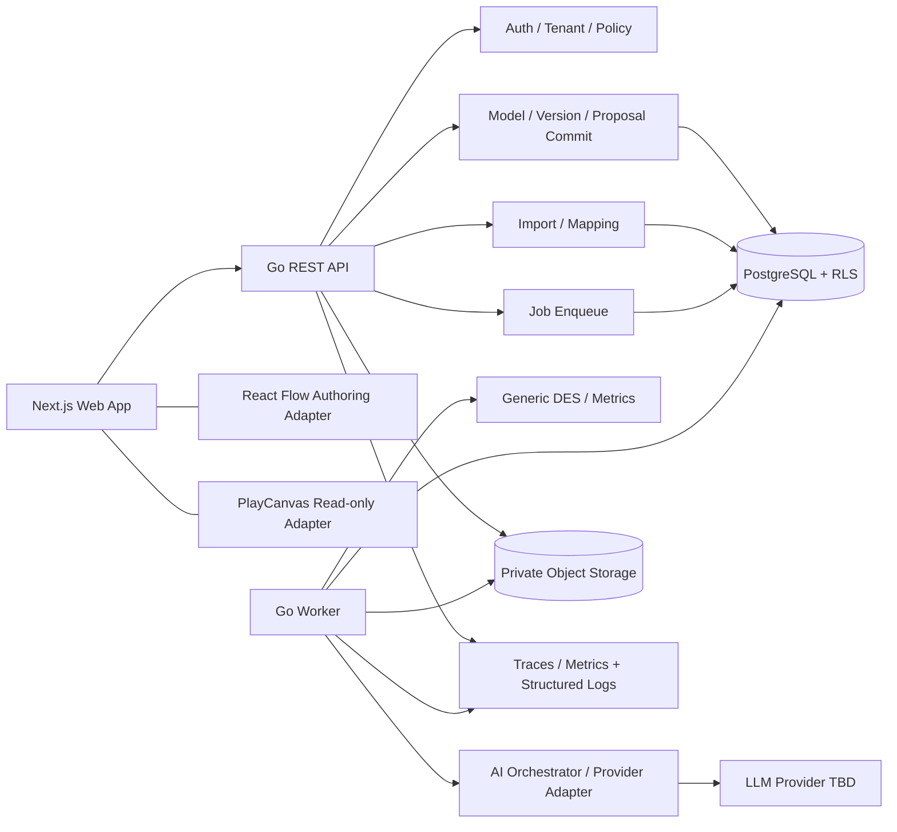

# Architecture & Module Responsibilities

SOURCE：原報告 pp. 8–14、19–23、27–28、36–43、49–53。補充 transaction、worker isolation 與接口參數為工程補充（D-003、D-006、D-008–D-013，皆已批准）。

## 1. Runtime topology

採 modular monolith + separate worker，對應原報告第 8 頁架構圖。P0 不拆成多個 microservices。



箭頭是受控調用，不表示 LLM 可反向寫資料庫。API 與 worker 共用純 domain packages、schema 與 storage interfaces；runtime credentials 和 grants 分開。LLM SDK type 不得出現在 domain signatures。

## 2. 模組責任與禁止依賴

| Package / feature | Owns | 不得負責 |
|---|---|---|
| internal/auth | JWT verification、subject extraction、issuer/audience/expiry（T-008，ADR-017） | 信任 client role／選擇任意 tenant |
| internal/tenant | membership、organization authorization、transaction context；`RunSelf`：只設 user、不選 organization 的唯讀 transaction（D-045，RLS 只顯示自己的 membership 與其 organization）；`me`：`GET /v1/me`（自己的 user ID 與 membership）；`memberships`：owner 的成員管理（T-010）；`workerscope`：worker 在指派的 organization 執行（不查 membership，只有 worker 端可 import，T-019） | 以 hidden UI button 代替授權；以 `/me` 的 role 授權 |
| internal/project | tenant project lifecycle（T-009：create／list／get，idempotent create 與 audit 同一 transaction） | 直接處理 IR 或 DES；自己寫 SQL |
| internal/httpapi | HTTP transport（ADR-019）：error envelope、request ID、schema 驗證的 JSON body、token→`tenant.Scope` middleware（`Scoped`）、只驗 token 與解析 user 的 `Self`（D-045，拒絕 `X-Organization-ID`） | business rule；從 header 或 body 取得 role |
| internal/api | 把所有 route 組成 cmd/api 與整合測試共用的 handler | business rule |
| internal/ids | D-001 ID（`<prefix>_<ULID>`） | — |
| internal/model | IR types、validation、JSON Patch、hash（generic kernel；不依賴 storage、tenant 或 pack） | provider-specific prompt、renderer layout runtime |
| internal/models | model／draft／version service（T-012，ADR-022）：create from template、draft CAS 與 issues、publish、reset、版本推進規則（`Service.Advance`，T-026 的批准也用它）；每個寫入先鎖 model row；HTTP adapter（T-013：If-Match／ETag、錯誤對應） | 自己寫 SQL；在 generic kernel 內 |
| internal/domainpack | catalog、domain rules、event inference、domain metrics、prompt context、default views | 修改 generic engine source 才能加 domain |
| internal/import | file profile、column map、row validation、frozen datasets、inference proposal。T-016：`upload`（上傳、讀取與 error report 的 service 與 HTTP adapter）、`profile`（純粹的串流 CSV／JSON profile 與 preview）、`report`（formula-safe 的 error report）、`profiler`（`import_profile` job handler，只有 cmd/worker 連結）。T-017：`mapping`（純粹的 mapping 檢查與每列的 canonical event）、`validation`（純粹的全量 validation 與 canonical dataset 的串流寫出）、`validator`（`import_validate` job handler，只有 cmd/worker 連結）、`upload/mapping.go`（saveImportMapping 的 service）；commit 屬 T-018 | 未批准直接 publish Twin；`profile`、`report`、`mapping`、`validation` 碰 storage、tenant、HTTP 或檔案（`import-parsing-is-pure`）；cmd/worker 以外的程式連結 `validator`（`job-handlers-only-in-the-worker`） |
| internal/ai | sanitized context、provider interface、typed outputs、validation orchestration（T-024，ADR-027 ACCEPTED（H-019）：`aicontext` 建 sealed prompt，`provider` 是 client 與 fake／disabled／live 模式，`provider/anthropic` 是唯一連結 LLM SDK 的 live adapter，`idpool`（D-046）、`locale`（REQ-022、prose 數字檢查）、`corpus`（fake provider 的 `make ai-eval`）；T-025：`review` 是 server 對 provider 回答的 review（patch、candidate validation、ID pool、pack、expected effects、server risk），純函式）） | 直接持有 ModelCommitter、SQL handle、production tool；讀環境變數取得 key |
| internal/proposals | AI proposal service（T-025）：建立（role、idempotency、AI 可用性、base 是否為 latest、server 產生 ID pool、與 `model_proposal` job、audit 同一 transaction 入列，202）、list、get；各狀態只顯示它有的內容（T-026 起決定後的狀態另有決定者、時間與 comment，D-068 PROPOSED）；HTTP adapter 在 `http.go` | 呼叫 provider；自己寫 SQL；approve 或 reject（在 `internal/proposals/approval`） |
| internal/proposals/approval | 人類的決定（T-026，D-067–D-069 PROPOSED）：approve／reject 的 service 與 HTTP adapter。一個 transaction：role、Idempotency-Key，再依序鎖 model row、draft、proposal（§4 的順序）；只批准 ready；base 已不是 latest 時 proposal 轉 conflicted 並回 409（存為該 key 的回應）；以 `internal/ai/review` 對存下的內容再 review 一次並重跑 dataset binding stage（不採信存下的 validation、risk、hash）；edit 建立恰好一個 version 並以 `internal/models` 的 `Service.Advance` 套用 draft 規則，scenario 建立恰好一個 scenario；決策紀錄、audit、idempotency response 同一 transaction | 呼叫 provider；被 worker、job handler、其他 service 或 `internal/ai` 連結（規則 `decisions-only-in-the-api`）；自己寫 SQL；自動 rebase |
| internal/proposals/generator | `model_proposal` job handler（T-025，adapter；實作 `internal/worker/handler.Handler`，只有 cmd/worker 連結）：在 lease 下讀 proposal 與 base，在 transaction 外建 context、讀取並驗證 base 的 dataset snapshot（在呼叫 provider 之前）、呼叫 provider、review、以讀好的 snapshot 跑 dataset binding stage，結果與 job 的完成同一 transaction 寫入 | 放進 `internal/ai`；寫 model、draft 或 version；在 transaction 中等 provider |
| internal/secret | 不會被印出、log 或 JSON 序列化的 secret 字串型別（T-024；config 與 live adapter 共用） | 任何 business rule |
| internal/simulation | heap、clock、RNG、resource queues、routing、metrics；有限緩衝與阻塞（D-049）與 D-050 B1 的 `ErrDeadlock`（T-047，des-go-0.2.0） | HTTP/DB/network、tenant discovery、UI；呼叫 SimPy 或任何 reference（`scripts/simpy_reference.py` 只在測試中讀 engine 的輸出） |
| internal/results | aggregation、comparison、evidence catalog、trace artifacts | AI 自己计算未供應的實際數值 |
| internal/audit | append-only events、request correlation | raw prompts/secrets/chain-of-thought |
| internal/runs | simulation run service（T-023）：凍結 version／patch／config／datasets／engine／limits 後與 job、audit、idempotency response 同一 transaction 入列（202）；list／get／cancel；results；sampled trace 授權後串流（D-044）；SSE progress（每個事件前重新檢查 membership 與 role，TEST-026）；HTTP adapter 在同一 package 的 `http.go`（與 internal/models 相同） | 自己寫 SQL；執行 engine；信任 client 送來的 limits |
| internal/runs/runner | simulation job handler（T-023；實作 `internal/worker/handler.Handler`，只有 cmd/worker 註冊）：在 lease 下讀凍結的 input、在 transaction 外執行 `internal/simulation/des`、以 durable reservation 分批授予 event credit、checkpoint 寫 progress 並讀 cancellation、結果與 trace metadata 與 job 的結束同一 transaction commit | 放進 generic kernel；跨 tenant 掃描；lease 失去後寫入 |
| internal/storage | tenant-aware repos、object adapter、transactions；`auditlog`（同一 transaction 的 audit append；user 與 worker event）、`idempotency`（D-011）、`projects`、`models`（models／drafts／versions 與 binding rows）、`jobs`（佇列、lease fence、重試、reaper、取消；T-019，ADR-024）、`runs`（simulation_runs、run_datasets、simulation_results 的 SQL；T-023）、`imports`（imports 的上傳與 profile；T-016）、`objects`（D-044 的最小 object storage 介面與只給 development／test 的 filesystem adapter）、`snapshots`（以 object storage 實作 `datasets.Store`，讓 binding stage 本身不碰 DB 與 object I/O）、`proposals`（ai_proposals 的 SQL；T-025；T-026 加上 approve、reject、conflict 的決策寫入）、`scenarios`（scenarios 的 insert 與 get；T-026，人工 scenario 與 list 屬 T-028） | 將 untrusted organization_id 自動當授權 |
| internal/worker | job 迴圈（T-019，ADR-024）：逐 organization reap 與 claim、heartbeat、在 lease 結束前停止 handler、attempt 結果的記錄；`handler` 子 package 是 handler 的介面（`Run`：`Job`、`Checkpoint`、`Finish`），不依賴 worker scope | handler 的 business rule；跨 tenant 掃描或 BYPASSRLS |
| cmd/api / cmd/worker | composition root、config、lifecycle | 隱藏 business rule 或不同版本 validator |
| apps/web/features | editor、import、proposals、simulations、results、3D | 第二套 topology、server authorization |

## 3. 四個穩定 contracts

**Model IR**：JSON + schemas/model-ir.schema.json；UI、AI、import、engine 與 future domain 的唯一 model interchange。React Flow nodes/edges 只是投影。T-046 phase 2 起 IR 有 ADR-026 的 optional 產線成員（TWIN_IR_SPEC §2.1）；在實作它們的任務（T-047–T-051）之前，`internal/model/validate` 的 primitive support 階段與 `internal/simulation/engine` 的 kernel 支援清單各自以 `PRIMITIVE_NOT_SUPPORTED` 拒絕用到它們的模型（D-063 APPROVED，H-019），所以 publish、scenario、AI proposal 與 run 都不會把它們當作不存在。兩個清單都在 generic kernel 中，不依賴任何 pack。

**DomainPack**（保留原報告接口概念）：

```go
type DomainPack interface {
    ID() string
    NodeCatalog() []NodeDefinition
    ResourceCatalog() []ResourceDefinition
    Validate(ModelIR) []ValidationIssue
    InferFromEvents(context.Context, CanonicalEventDataset) (*InferenceResult, error)
    ComputeMetrics(SimulationResult) map[string]Metric
    PromptContext() DomainPromptContext
    DefaultViews(ModelIR) ViewDefinitions
}
```

T-011 實作（`internal/domainpack`）：介面保留上列方法；packs 由 process 明確註冊進 `Registry`，未註冊的 domain 回 `ErrUnsupportedDomain`。`SoftwareDeliveryDomainPack` 的 `InferFromEvents` 在 T-027 前回 `ErrUnavailable`（不假裝推論）；`ComputeMetrics` 在沒有已批准的 deployment／failure／recovery mapping 時把五個 DORA 指標全部標為 unavailable 並附原因（D-010）；`DefaultViews` 保留既有 2D 位置，其餘以 BFS 分層的決定性排版補齊；建立 model 用的 template 是 D-017 synthetic full pipeline（與 `testdata/golden-models/default-delivery.json` 由測試保持一致）。

T-042 實作（boundary guard，test-only，不是第二個產品 domain）：`internal/domainpack/conformance` 是 DomainPack conformance suite，pack 的測試以自己 domain 的 valid models 呼叫 `conformance.Run`。它檢查：ID 是合法的 IR domain 且穩定；catalog 只用 generic node／resource types、kind 不重複、回傳的是副本；`Validate` 不改 IR、決定性、對其他 domain 與 nil 回 `DOMAIN_MISMATCH` error（fail closed）；`DefaultViews` 只回本 IR node ID 的 2D positions（不多不少、不重疊、保留已存位置、套回 IR 後仍 valid，3D 由 2D 推導，沒有另一份 topology）；`ComputeMetrics` 不改 engine 的 Result、generic 指標不變、Result 通過 schema、digest 可重現；`InferFromEvents` 對空 dataset 與取消的 context 必須回錯誤且不帶結果（不捏造 model），有 events 時只能回錯誤（不帶結果）或本 domain 的 valid model，同一 dataset 兩次結果相同（ID 由 server 分配，D-016）；`PromptContext` 與 catalog 是靜態資料：在 pack 看過任何 IR 之前與看過帶 sentinel 的 model、events 之後相同，且不含 sentinel；pack 是 stateless：看過 sentinel model（名稱與所有 ID 都帶 sentinel）後對每個 model 的 `Validate`、`DefaultViews`、`ComputeMetrics` 回答不變；包含 `ComputeMetrics`、`InferFromEvents` 在內的並行呼叫結果一致（data race 由 `make backend-race` 檢查）；engine 的 generic 指標、seed 與 hashes 不因 pack 而變。另外把同一 IR 與其破壞單一規則的變體（未知 flow 目標、重複 ID、機率和、沒有 sink、錯誤 triangular、metadata 過深、constraint 不成立、zero-time cycle：validator 每個 stage 至少一個）改名為不相干的 domain 後，generic validator 的 issues 必須完全相同，engine 必須能執行且數字完全相同（kernel 不讀 domain，TEST-002）。`softwaredelivery.Pack` 與只存在於測試檔的 generic queue pack（`generic_queue`，service counter）都通過。`scripts/check-architecture`（`make architecture-check`，CI backend job）從 `go list -e -deps -test` 的 build graph 檢查遞移依賴；graph 是 8 個平台（linux amd64／arm64／ppc64le／s390x／riscv64／loong64、darwin arm64、windows amd64）× cgo 開／關的聯集，任何平台都不編譯的檔案（自訂 build tag）本身即違規，`./...` 的 module 全部 package 都檢查（`go.mod` 以 `ignore` 排除 `apps/web/node_modules`），被 import 卻不在 `./...` 中的 package（`testdata`、`_` 開頭的目錄）本身即違規：generic kernel（`internal/model`、`internal/simulation`、`internal/results`、`internal/domainpack` 介面、`schemas`）不依賴任何 domain pack、application layer、test helper、網路／DB／process I/O、DB driver 或 LLM SDK，第三方只允許 jcs、jsonschema 與 x/text 中 message catalog 連結的 package（`language`、`message/...`、`feature/plural`、`internal/...`）；kernel 與 pack 的遞移依賴中，module package 只能是 kernel（與 pack 自己的 unit），第三方只能是上述 allowlist，自己 import 的標準函式庫只能是計算、編碼、hash 與 embed 類的 allowlist（`kernelStd`；不含 `os`、`syscall`、`unsafe`、`io/ioutil`、`path/filepath`、`text/template` 等會在底下碰檔案或網路的 package），且只能有 Go 原始檔（不得有 assembly、C 或 `.syso`）。Import 規則看不到經 `fmt.Print`／`log`／`print` 寫 stdout／stderr、`time.LoadLocation` 讀 zoneinfo，以及允許的第三方 package 內部的檔案存取（jsonschema 的 `FileLoader`），由 review 與 determinism golden 涵蓋；kernel 的測試也不 import 具體 pack；pack 是 `internal/domainpack` 的直接子 package、只建在 kernel 上、互不依賴，其 subpackage 只能由 pack 自己 import 且不得依賴 DomainPack 介面；這不能保證一個 package 一個 pack（同 package 的第二個 pack 型別、subpackage 的 generic pack 都通過），因此 `domainpack.NewRegistry` 在登錄時要求每個 pack 的型別宣告在自己的直接子 package、一個 package 一個 pack；conformance suite 不指名具體 pack；production code 不連結 `testing` 或 test helpers；LLM SDK 只在 `internal/ai`（與 cmd），DB driver 只在 storage／tenant（與 cmd），storage 的基礎層 `internal/storage/postgres`（可用任何連線字串開連線）也只在 storage、tenant 與 cmd（`db-handles-only-in-gateways`，T-009 review）；`internal/ai` 不得取得 SQL handle、storage、tenant scope 或 `os/exec`（此規則在 package 建立前標為 future；T-024 起生效，見 §3 ModelChangeProposal 的 T-024 段落）。Go 無法 import 前端型別；前端的 LLM／DB import 由 ESLint `no-restricted-imports` 擋（`apps/web/tests/lint-guards.test.ts`）。

**SimulationEngine**（原報告接口）：

```go
type SimulationEngine interface {
    Validate(context.Context, ModelIR) ([]ValidationIssue, error)
    Run(context.Context, ModelIR, RunConfig, ProgressSink) (*SimulationResult, error)
}
```

APPROVED D-006：worker 在呼叫前組裝 immutable `RunInput`，包含 ModelIR、resolved empirical datasets、dataset manifest、effective model hash 與 frozen config。可以把 resolved dataset bindings 放入 RunConfig 的 internal-only 欄位或一個 explicit RunInput；**不能讓 pure engine 在 Run() 中查 DB／object storage**。T-003 必須確認 Go interface 的最終編碼，不自行隱藏可變全域 resolver。

**ModelChangeProposal**：provider 只能供應內容；server 綁定 identity/base/mode/status/validation，經人類批准才觸發 canonical commit。Schema 分 provider output、stored proposal、approval response，避免把 readOnly 註解當 security boundary。

T-024 實作（[ADR-027](adr/ADR-027-ai-provider-adapter.md)，ACCEPTED，H-019）：AI 呼叫分三層。`internal/ai/aicontext` 從呼叫端已在 tenant scope 中讀好的資料建 prompt（不碰 DB）：其他 organization 或 model 的輸入一律拒絕（typed error，不靜默過濾）；credential、URL、email、IP、D-001 server ID 與不可見字元先遮蔽；字串、列數、摘要有上限，超出 budget 時依序省略並把省略寫進 `CONTEXT_OMISSIONS`；server rules 在 system text，使用者與 import 的資料只在 `<untrusted_data>` block（內容 HTML-escape，無法偽造 block）；只依 DomainPack 的 `PromptContext` 帶 domain 文字，本身不含任何 domain 名詞。`internal/ai/provider` 的 `Client` 在呼叫 backend 前檢查 prompt 的 hash、role、organization 與大小，限制每個 organization 的並行數與 timeout，回答先經 schema 驗證再 strict decode，錯誤只留 path 與固定訊息；模式為 `disabled`（預設，回 `provider_not_configured`／`policy_not_approved`）、`fake`（只在 development／test）與 `anthropic`（live）。`internal/ai/provider/anthropic` 是唯一連結 LLM SDK 的 package：key 由 config 明確注入、不讀環境變數，依 D-018 只在 401／402／403 換下一把 key，429／529／5xx 只在同一把 key 重試；規則 `ai-is-pure-but-the-adapter` 讓 `internal/ai` 的其他 package 只能用 kernel 的標準函式庫與第三方 allowlist（沒有網路、檔案、DB、process），`ai-suggests-only` 禁止整個 `internal/ai` 依賴 storage、tenant、DB driver、`database/sql`、application layer 與 `os/exec`。Proposal 的 ID allocation pool（D-046）存在 `ai_proposals.id_pool`（migration 0011，建立後不可改）。Live AI 仍關閉：config 只在 owner 已登記的核准下接受 `AI_PROVIDER=anthropic`，而登記清單（leaf package `internal/config/aiapproval`）是空的（H-017）；adapter 只接受該 package 才能產生的 `Approval` token，`ai-suggests-only` 只讓 `internal/ai` 依賴 `internal/config` 的這個 leaf（review L5）。

## 4. Model / draft / version / scenario 生命週期

Create 以單一 DB transaction 建 model、valid template v1、draft revision=1/base=v1。Draft 可改，但每次 mutation 帶 If-Match。Publish 鎖 model row，驗 base/latest 與 revision，建立 parent-linked version、同步 draft。Version content 永不 UPDATE。

APPROVED D-003：approval 的 lock order 為 model → draft → proposal → idempotency completion（idempotency reservation 先做，但不得與其他操作造成反向鎖順序）。先完成授權與 key reservation，再以一致的 domain lock order 執行。若 draft content 與其 base 完全相同且 base=latest，可同步新版本並增加 revision；dirty draft 不動，回應 `draft_out_of_date=true`。下一次 publish stale draft 必須顯式處理，不會偷偷 rebase。

T-026 實作（`internal/proposals/approval`）：approve 與 reject 都在 membership 的 `FOR SHARE`（`tenant.DB.Run`）與 Idempotency-Key 的 claim 之後，依序 `LockModel`、`LockDraft`、鎖 proposal，所以同一 model 的批准、拒絕、publish、draft 編輯輪流進行；worker 只鎖 job 再鎖 generating 的 proposal，不鎖 model，沒有反向的順序。Draft 規則與 publish 共用 `internal/models` 的 `Service.Advance`（clean 對 draft 自己的 base 判斷，T-012 review L3）。Scenario 的批准不碰 model、draft 與 version。

Scenario 是 ModelVersion + ordered JSON Patch 的 immutable experiment description。AI scenario approval 寫 scenario，不寫 ModelVersion；run 在 enqueue 時 freeze patch，不從 mutable scenario/config 取得資料。

## 5. Request / transaction boundary

APPROVED D-008：每個 tenant request 的順序為 verify JWT →取得 subject→begin transaction→SET LOCAL organization_id/user_id→查 membership→role check→scoped query + RLS。X-Organization-ID 只是 tenant selector，header 不含可信 role。resource 的 org 與 URL parent 必須一致；其他 tenant 的 ID 回 not found，不揭露其存在。

不能在 DB transaction 中等待 LLM 或跑 DES。enqueue：transaction 內建立 resource/status + job + audit + idempotency response → commit →202。worker 讀 snapshot、commit claim →transaction 外執行→用 lease fence 的 transaction commit result。

## 6. Queue / storage / isolation

PostgreSQL jobs 使用 `FOR UPDATE SKIP LOCKED`，P0 不加入 broker。APPROVED D-008：worker 只輪詢 deployment 指派的 organization allowlist，逐 tenant 設 transaction-local context；**不提供跨 tenant 的 unrestricted jobs SELECT，也不授 BYPASSRLS**。之後若需要 dispatcher，用獨立 ADR 設計最小權限接口，不把 security-definer global scanner 偷塞進 worker。

T-019 實作（[ADR-024](adr/ADR-024-job-queue-and-worker.md)，ACCEPTED，H-010）：`internal/storage/jobs` 是佇列（enqueue 與 resource、audit 同一 transaction；claim 依 priority／created_at／id、`SKIP LOCKED`；以 organization、job、worker、lease token 為 fence 的 heartbeat、lock、complete、cancel、fail；有限 backoff 的重試；逐 organization 取回過期 lease 的 reaper；queued job 立即取消）；migration 0007 在 DB 端強制 job 的生命週期（終態不可改、identity 與輸入不可改、attempt 與 token 不回退、queued 一定還有 attempt），並限制各 runtime role 只做自己的那一步（API 只能 enqueue、取消或重排 queued job；worker 從 queued 只能 claim，running 的 job 只能續期自己的 lease、離開 running 時清除；其他 role 一律拒絕）。`internal/tenant/workerscope` 是唯一的 worker scope，只有 `cmd/worker`、`internal/worker` 能依賴（architecture rule `worker-scope-only-in-the-worker`）。`internal/worker` 是迴圈：每次 pass 依序走過 `WORKER_ORGANIZATION_IDS`，每個 organization reap 後至多執行一個 job，heartbeat 從 claim 開始起每個 heartbeat 依序續期（每次至多一個 heartbeat），並在 DB 的 lease 結束前（最後一次成功續期開始後 lease 減半個 heartbeat）或 lease 失去時停止 attempt；停止之後 handler 的 transaction 不會 commit，進行中的被取消並 rollback（呼叫回傳停止的原因並包住 `fn` 的 error），只有已送出的 COMMIT 例外：不論 DB 之後是否 commit，handler 都會得到 `tenant.ErrOutcomeUnknown`（可能已 commit）。Handler 實作 leaf package `internal/worker/handler`（不依賴 worker scope），以 `Checkpoint` 在 lease 下讀寫、以 `Finish` 讓結果與 job 的結束（completed 或 cancelled）一起 commit；handler 讀寫 DB，是 adapter，不放在 generic kernel 或 `internal/ai` 之中。`cmd/worker` 只組裝設定、連線（worker runtime role 檢查與 pool guard）與生命週期；T-023 起註冊 simulation handler（`internal/runs/runner`），T-016 起註冊 import profile handler（`internal/import/profiler`），import validation 與 AI 的 handler 屬 T-017、T-025；沒有任何 handler 的 build 仍以 exit 2 拒絕啟動。

T-016 實作：上傳在 API（`internal/import/upload`）先授權再讀 body，串流寫入 object storage，與 `import_profile` job、audit 同一 transaction 入列；profile 在 worker（`internal/import/profiler`）的 lease 下進行，讀 object 時核對大小與 SHA-256，解析與統計在 transaction 外，結果與 job 的 completed 一起 commit。解析與 error report 是純 package（`internal/import/profile`、`internal/import/report`：只讀寫 bytes），規則 `import-parsing-is-pure` 禁止它們依賴 storage、tenant、HTTP、DB、檔案或 process；規則 `job-handlers-only-in-the-worker` 同樣只讓 `cmd/worker` 連結 `internal/import/profiler`（probe：cmd/api、internal/import/upload）。上傳與 profile 都不碰 model、draft 或 version（D-009）。解析的記憶體不隨檔案成長：CSV record 與 JSON events 的一列至多 1 MiB，在讀取時強制（T-016 review H1）；import 的 status 只記在自己的 row，profile job 失敗或被取消時由 migration 0010 的 trigger 讓 import 跟著變 FAILED（review M1），API 不在讀取時推導。

T-023 實作（package 名稱由本任務決定）：tasks.json 原規劃的 `internal/simulation/service`、`internal/simulation/http` 會落在 generic kernel 之下，而 kernel 規則禁止 DB、HTTP、tenant 與 storage 依賴（§3 T-042 段落、T-019 round 2 L3），所以改為 `internal/runs`（service 與 HTTP adapter，對應 `internal/models` 的做法）、`internal/runs/runner`（job handler，adapter）、`internal/storage/runs`（SQL）。`scripts/check-architecture` 把 `internal/runs/...` 與 `internal/worker/...` 列為 application layer，kernel 與 pack 不得依賴它們。部署服務的 domain pack 只在 `internal/packs` 列出一次（`packs.Registry`），API（`internal/api`）與 worker（`cmd/worker`）都由它建立 registry，規則 `packs-named-in-one-place` 禁止其他 production package 指名具體的 pack，`cmd/worker` 的 `TestTheWorkerServesTheAPIsPacks` 比對 worker 登錄的 simulation handler 與 API 服務的 domain（T-023 review L2：否則 API 接受的 run 會在 worker 以 `RUN_INPUT_INVALID` 永久失敗）。規則 `job-handlers-only-in-the-worker` 只讓 `cmd/worker` 連結 `internal/runs/runner`：API 與它共用的 service 都不能，所以沒有 request 能執行 engine 或以 worker 身分寫入（probe：cmd/api、internal/models）。Run 的狀態跟隨 job：migration 0009 的 `follow_simulation_job` trigger 在 job 回到 queued、failed 或 cancelled 時把 run 帶到同一狀態（worker 迴圈記錄的 failure 與 reaper 都經過它，不需要改 T-019 的程式），run 的 completed 只能由持有 lease 的 `Finish` 與 result 一起寫入；`protect_run_lifecycle` 依 role 限制誰能做哪一步（API 只能請求取消，worker 只能開始與完成，其餘由 trigger 跟隨）；queued／failed／cancelled 對任何 role（含 owner）都只能由 job 帶動，completed 只能與 job 的 completed 同一 transaction（T-023 review L1：否則 reaper 會卡住整個 organization）。API 的取消與 worker 的 finalize 都先鎖 job 再鎖 run（ADR-024 的順序），所以兩者輪流進行，後者看得到前者的結果。

T-025 實作（package 名稱由本任務決定）：tasks.json 原規劃 `internal/ai/proposals/`。但 handler 讀寫 DB，`ai-suggests-only` 禁止 `internal/ai` 依賴 storage 與 tenant，所以拆成四個 package。`internal/ai/review` 是純粹的 server review（與 `internal/ai/review/codes.go` 的 `ID_POOL_VIOLATION`、`AI_OUTPUT_INVALID`）。`internal/proposals` 是 service 與 HTTP adapter（與 `internal/runs` 的做法相同）。`internal/proposals/generator` 是 job handler（adapter，與 `internal/runs/runner` 相同）。`internal/storage/proposals` 是 SQL。`scripts/check-architecture` 把 `internal/proposals/...` 列為 application layer；`job-handlers-only-in-the-worker` 只讓 cmd/worker 連結 generator（probe：cmd/api、internal/runs；internal/proposals 連結它時，generator 的測試會形成 import cycle，所以根本無法編譯）。另有 probe 確認 review 不依賴 service、storage 與檔案，kernel 不依賴 service。Proposal 跟隨它的 job（migration 0012，D-062 APPROVED，H-019）。`protect_proposal_lifecycle` 限制哪個 role 能做哪一步：API 只能在 `generating` 時建立，之後不能改；worker 只能在 job 完成的同一 transaction 中把 `generating` 寫成 `ready`／`needs_input`／`invalid`（deferred constraint trigger `proposal_generated_with_its_job`）。Job failed 或 cancelled 時，由 `follow_proposal_job` 把 proposal 轉為 `failed`，並帶 job 的 failure。Provider 呼叫、review 與 dataset binding 都在 transaction 外進行。Handler 在 Finish 中重新鎖 proposal，確認它仍是 `generating` 才寫入。Provider 錯誤以固定訊息作為 job failure；可重試的錯誤由 ADR-024 的 attempt 上限決定（D-061 APPROVED，H-019）。API 與 worker 的 AI 模式都由 config 決定：fake 只在 development／test；live 需要 owner 已登記的核准，目前清單是空的；其他情況 API 回 503，worker 以 Disabled client 讓 job 失敗。

T-026 實作（package 名稱由本任務決定）：tasks.json 原規劃 `internal/model/approval/`，但 `internal/model` 是 generic kernel（§3：不依賴 storage、tenant、DB、HTTP），而批准讀寫 DB、呼叫 model service 與 storage，是 adapter，所以改為 `internal/proposals/approval`（service 與 HTTP adapter，與 `internal/proposals`、`internal/runs` 相同；`internal/proposals/...` 已列為 application layer）。SQL 在 `internal/storage/proposals`（`Approve`、`Reject`、`Conflict`）、`internal/storage/scenarios`（新）與 `internal/storage/models`（`LockDraft`）。它不放在 `internal/proposals`，因為它要連結 model service（`internal/models`），而規則可以單獨限制誰連結它：`decisions-only-in-the-api` 只讓 `cmd/api`、`internal/api` 連結它，所以 worker、job handler、其他 service 與 `internal/ai` 都無法批准（probe：cmd/worker、internal/runs/runner、internal/runs、internal/ai/aicontext；`internal/proposals`、`internal/models`、`internal/ai/review` 被 approval import，連結回去會形成 import cycle，根本無法編譯）。Revalidation 呼叫 `internal/ai/review.Review` 這個純函式，`ai-suggests-only` 仍禁止 `internal/ai` 依賴 approval。Migration 0013 在 DB 端要求以 proposal 為來源的 version 或 scenario 在 commit 時是那個 approved proposal 自己的 effect（D-069 (e) PROPOSED）。

Budget 的語意（D-007 的「durable budget reservations、有限批次 credit」）：wall clock 從 run 第一次開始起算（`execution_deadline_at`，retry 不重設），每個 attempt 只拿剩下的時間；events 先保留再使用：attempt 開始時保留第一批，engine 需要更多時以 `engine.Credit` 要求下一批（預設每批 max_events 的十分之一），每批都在 lease 下寫入 `event_budget_reserved`（只增不減、不超過 max_events）後才能使用。之前 attempt 保留的 events 一律算作已用，所以 crash 最多浪費最後一批中未用的部分，整個 run 用掉的 events 不超過 max_events。Engine 只看到授予的 credit 與 context，不讀 DB。

大檔與 trace/result artifact 放 private object storage，DB 放 metadata、hash、organization_id、authorized object key。client 只能持有 resource ID，不可送任意 bucket/key/url 讓 server 讀取。empirical datasets 在編譯前下載驗 hash、轉換 units、freeze；run 中斷網不影響純 DES。D-044 的介面在 `internal/storage/objects`（`Store`：Put 時計算 SHA-256 與大小、不覆寫既有 key；Get；`Maintainer.Delete` 只給受控 maintenance）；`FS` 是只給 development／test 的 filesystem adapter（`OBJECT_STORAGE_PROVIDER=filesystem` 只在 `APP_ENV` 為 development 或 test 時接受，production 拒絕啟動；其他 provider 為 not implemented）。cmd/api 與 cmd/worker 依設定建立同一個 store；沒有設定時，需要它的 run（綁 dataset 或記錄 sampled trace）在入列時回 503，不會入列後才失敗。Trace 的 key 為 `tenant/<org>/simulation-results/<run>/<artifact>.json`，每個 attempt 一個新的 key，所以 retry 從不覆寫已存在的 object；上傳成功但 commit 失敗時留下的孤兒 object 由日後的 maintenance 清理（尚未實作）。

## 7. Frontend adapters

server state（versions、proposals、jobs）與 unsaved draft/editor state 分開（T-014 實作見 ADR-016：`apps/web/lib/api` 為唯一 HTTP 出口、`lib/state/draft.ts` 分開 remote／in-flight／unsaved，409 保留本機編輯且不自動 rebase）。ViewAdapter 以 IR ID 建立 React Flow nodes/edges；2D positions 是 views 的資料，不是 domain semantics。3D derives topology 與 layout，不可回寫 graph；same selectedEntityId store 支援切換 renderer。Playback loader 與 aggregate results 分離，可按需取 authorized sampled trace。

Browser session 採 BFF（ADR-018）：Next.js 伺服器端持有 OIDC client 與 token，瀏覽器只呼叫同源 `/api/v1/...`，由 BFF 轉成 Bearer 給 Go API；Go API 不讀 cookie。語言（REQ-022，T-044）：UI 字串只來自 `en`（預設）與 `zh-Hant` catalog，語言偏好存在 cookie（不含敏感資料、不影響授權），API 只回語言中立的 error code 與英文開發者訊息，由 UI 依 code 顯示；使用者輸入的名稱、label 與 dataset 內容是資料，不翻譯；template 建立時的預設名稱依建立者的語言（domain pack 提供兩語名稱，ID 不變）。T-044 實作見 ADR-020（ACCEPTED，H-006）：自寫 typed catalog（`apps/web/messages/`，zh-Hant 型別對齊 en key）與 `apps/web/lib/i18n/`（插值、Intl 複數／日期／數字／期間）；cookie `geminus_locale` 只存 `en`／`zh-Hant`，root layout 在 server 端讀取並設 `<html lang>`，route 無語言前綴；server 的 message 與未知 validation code 的 reason 以 `lang="en"` 顯示為技術細節；ESLint 擋 `.tsx` 中硬編的使用者可見字串（限制見 ADR-020）。Template 經 optional `domainpack.TemplateProvider`（`DomainPack` method set 不變），conformance suite 的 `templates` 步驟檢查每個 locale 產生同一個 model、只差名稱。

AI review 必須顯示 base version、candidate effective diff、server-computed risk、assumptions、validation。Scenario approval 與 publish 的 UI copy 不可混淆。所有 pending/needs_input/invalid/conflicted 狀態都有明確下一步，不把 provider timeout 當空 patch success。

## 8. Deployment / observability / failure modes

部署單位：web、api、worker、managed PostgreSQL、object storage、OTLP backend。cloud/provider/retention TBD；Cloud Run 僅原報告 reference，不寫進 domain code。structured JSON logs + trace correlation；不得依賴原報告當時對特定 SDK 版本的時效敘述。

Provider fail：proposal/analysis failed，不 mutation。DB commit fail：不回 successful 202/201。Worker crash：lease 回收、same frozen input retry。Artifact upload 成功但 DB commit fail：無可見 completed result，孤兒 artifact 由保留政策清理。Stale lease worker：不能 finalize。取消：checkpoint 後不產生 completed metrics；partial debug state 不被 analyst 當 final results。

## 9. 架構演進條件

保留原報告 trigger：代表性模型超出 SLO、profiling 證明 >60% runtime 是 DES compute、演算法與資料結構調整仍無效，才 benchmark Rust prototype。Broker 的導入依 queue latency / sustained throughput / cross-region / fanout 實測；不能因偏好而先引入。第二 domain 的測試以 minimal test pack 證明 generic boundary；不等於 P0 要交付 manufacturing。
