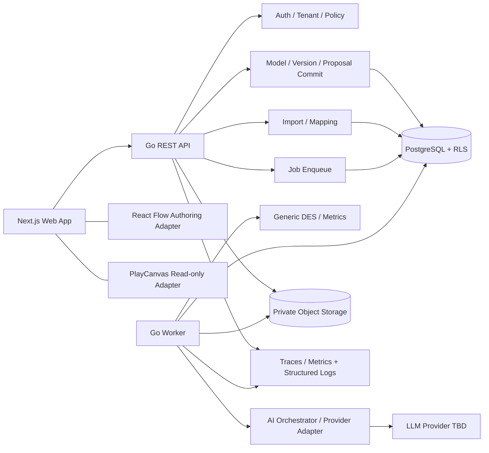

# Architecture & Module Responsibilities

SOURCE：原報告 pp. 8–14、19–23、27–28、36–43、49–53。補充 transaction、worker isolation 與接口參數為工程補充（D-003、D-006、D-008–D-013，皆已批准）。

## 1. Runtime topology

採 modular monolith + separate worker，對應原報告第 8 頁架構圖。P0 不拆成多個 microservices。



箭頭是受控調用，不表示 LLM 可反向寫資料庫。API 與 worker 共用純 domain packages、schema 與 storage interfaces；runtime credentials 和 grants 分開。LLM SDK type 不得出現在 domain signatures。

## 2. 模組責任與禁止依賴

| Package / feature | Owns | 不得負責 |
|---|---|---|
| internal/auth | JWT verification、subject extraction、issuer/audience/expiry（T-008，ADR-017） | 信任 client role／選擇任意 tenant |
| internal/tenant | membership、organization authorization、transaction context | 以 hidden UI button 代替授權 |
| internal/project | tenant project lifecycle（T-009：create／list／get，idempotent create 與 audit 同一 transaction） | 直接處理 IR 或 DES；自己寫 SQL |
| internal/httpapi | HTTP transport（ADR-019）：error envelope、request ID、schema 驗證的 JSON body、token→`tenant.Scope` middleware | business rule；從 header 或 body 取得 role |
| internal/api | 把所有 route 組成 cmd/api 與整合測試共用的 handler | business rule |
| internal/ids | D-001 ID（`<prefix>_<ULID>`） | — |
| internal/model | IR types、validation、JSON Patch、hash（generic kernel；不依賴 storage、tenant 或 pack） | provider-specific prompt、renderer layout runtime |
| internal/models | model／draft／version service（T-012，ADR-022）：create from template、draft CAS 與 issues、publish、reset、版本推進規則；每個寫入先鎖 model row；HTTP adapter（T-013：If-Match／ETag、錯誤對應） | 自己寫 SQL；在 generic kernel 內 |
| internal/domainpack | catalog、domain rules、event inference、domain metrics、prompt context、default views | 修改 generic engine source 才能加 domain |
| internal/import | file profile、column map、row validation、frozen datasets、inference proposal | 未批准直接 publish Twin |
| internal/ai | sanitized context、provider interface、typed outputs、validation orchestration | 直接持有 ModelCommitter、SQL handle、production tool |
| internal/simulation | heap、clock、RNG、resource queues、routing、metrics | HTTP/DB/network、tenant discovery、UI |
| internal/results | aggregation、comparison、evidence catalog、trace artifacts | AI 自己计算未供應的實際數值 |
| internal/audit | append-only events、request correlation | raw prompts/secrets/chain-of-thought |
| internal/storage | tenant-aware repos、object adapter、transactions；`auditlog`（同一 transaction 的 audit append）、`idempotency`（D-011）、`projects`、`models`（models／drafts／versions 與 binding rows） | 將 untrusted organization_id 自動當授權 |
| cmd/api / cmd/worker | composition root、config、lifecycle | 隱藏 business rule 或不同版本 validator |
| apps/web/features | editor、import、proposals、simulations、results、3D | 第二套 topology、server authorization |

## 3. 四個穩定 contracts

**Model IR**：JSON + schemas/model-ir.schema.json；UI、AI、import、engine 與 future domain 的唯一 model interchange。React Flow nodes/edges 只是投影。

**DomainPack**（保留原報告接口概念）：

```go
type DomainPack interface {
    ID() string
    NodeCatalog() []NodeDefinition
    ResourceCatalog() []ResourceDefinition
    Validate(ModelIR) []ValidationIssue
    InferFromEvents(context.Context, CanonicalEventDataset) (*InferenceResult, error)
    ComputeMetrics(SimulationResult) map[string]Metric
    PromptContext() DomainPromptContext
    DefaultViews(ModelIR) ViewDefinitions
}
```

T-011 實作（`internal/domainpack`）：介面保留上列方法；packs 由 process 明確註冊進 `Registry`，未註冊的 domain 回 `ErrUnsupportedDomain`。`SoftwareDeliveryDomainPack` 的 `InferFromEvents` 在 T-027 前回 `ErrUnavailable`（不假裝推論）；`ComputeMetrics` 在沒有已批准的 deployment／failure／recovery mapping 時把五個 DORA 指標全部標為 unavailable 並附原因（D-010）；`DefaultViews` 保留既有 2D 位置，其餘以 BFS 分層的決定性排版補齊；建立 model 用的 template 是 D-017 synthetic full pipeline（與 `testdata/golden-models/default-delivery.json` 由測試保持一致）。

T-042 實作（boundary guard，test-only，不是第二個產品 domain）：`internal/domainpack/conformance` 是 DomainPack conformance suite，pack 的測試以自己 domain 的 valid models 呼叫 `conformance.Run`。它檢查：ID 是合法的 IR domain 且穩定；catalog 只用 generic node／resource types、kind 不重複、回傳的是副本；`Validate` 不改 IR、決定性、對其他 domain 與 nil 回 `DOMAIN_MISMATCH` error（fail closed）；`DefaultViews` 只回本 IR node ID 的 2D positions（不多不少、不重疊、保留已存位置、套回 IR 後仍 valid，3D 由 2D 推導，沒有另一份 topology）；`ComputeMetrics` 不改 engine 的 Result、generic 指標不變、Result 通過 schema、digest 可重現；`InferFromEvents` 對空 dataset 與取消的 context 必須回錯誤且不帶結果（不捏造 model），有 events 時只能回錯誤（不帶結果）或本 domain 的 valid model，同一 dataset 兩次結果相同（ID 由 server 分配，D-016）；`PromptContext` 與 catalog 是靜態資料：在 pack 看過任何 IR 之前與看過帶 sentinel 的 model、events 之後相同，且不含 sentinel；pack 是 stateless：看過 sentinel model（名稱與所有 ID 都帶 sentinel）後對每個 model 的 `Validate`、`DefaultViews`、`ComputeMetrics` 回答不變；包含 `ComputeMetrics`、`InferFromEvents` 在內的並行呼叫結果一致（data race 由 `make backend-race` 檢查）；engine 的 generic 指標、seed 與 hashes 不因 pack 而變。另外把同一 IR 與其破壞單一規則的變體（未知 flow 目標、重複 ID、機率和、沒有 sink、錯誤 triangular、metadata 過深、constraint 不成立、zero-time cycle：validator 每個 stage 至少一個）改名為不相干的 domain 後，generic validator 的 issues 必須完全相同，engine 必須能執行且數字完全相同（kernel 不讀 domain，TEST-002）。`softwaredelivery.Pack` 與只存在於測試檔的 generic queue pack（`generic_queue`，service counter）都通過。`scripts/check-architecture`（`make architecture-check`，CI backend job）從 `go list -e -deps -test` 的 build graph 檢查遞移依賴；graph 是 8 個平台（linux amd64／arm64／ppc64le／s390x／riscv64／loong64、darwin arm64、windows amd64）× cgo 開／關的聯集，任何平台都不編譯的檔案（自訂 build tag）本身即違規，`./...` 的 module 全部 package 都檢查（`go.mod` 以 `ignore` 排除 `apps/web/node_modules`），被 import 卻不在 `./...` 中的 package（`testdata`、`_` 開頭的目錄）本身即違規：generic kernel（`internal/model`、`internal/simulation`、`internal/results`、`internal/domainpack` 介面、`schemas`）不依賴任何 domain pack、application layer、test helper、網路／DB／process I/O、DB driver 或 LLM SDK，第三方只允許 jcs、jsonschema 與 x/text 中 message catalog 連結的 package（`language`、`message/...`、`feature/plural`、`internal/...`）；kernel 與 pack 的遞移依賴中，module package 只能是 kernel（與 pack 自己的 unit），第三方只能是上述 allowlist，自己 import 的標準函式庫只能是計算、編碼、hash 與 embed 類的 allowlist（`kernelStd`；不含 `os`、`syscall`、`unsafe`、`io/ioutil`、`path/filepath`、`text/template` 等會在底下碰檔案或網路的 package），且只能有 Go 原始檔（不得有 assembly、C 或 `.syso`）。Import 規則看不到經 `fmt.Print`／`log`／`print` 寫 stdout／stderr、`time.LoadLocation` 讀 zoneinfo，以及允許的第三方 package 內部的檔案存取（jsonschema 的 `FileLoader`），由 review 與 determinism golden 涵蓋；kernel 的測試也不 import 具體 pack；pack 是 `internal/domainpack` 的直接子 package、只建在 kernel 上、互不依賴，其 subpackage 只能由 pack 自己 import 且不得依賴 DomainPack 介面；這不能保證一個 package 一個 pack（同 package 的第二個 pack 型別、subpackage 的 generic pack 都通過），因此 `domainpack.NewRegistry` 在登錄時要求每個 pack 的型別宣告在自己的直接子 package、一個 package 一個 pack；conformance suite 不指名具體 pack；production code 不連結 `testing` 或 test helpers；LLM SDK 只在 `internal/ai`（與 cmd），DB driver 只在 storage／tenant（與 cmd），storage 的基礎層 `internal/storage/postgres`（可用任何連線字串開連線）也只在 storage、tenant 與 cmd（`db-handles-only-in-gateways`，T-009 review）；`internal/ai` 不得取得 SQL handle、storage、tenant scope 或 `os/exec`（此規則在 package 建立前標為 future）。Go 無法 import 前端型別；前端的 LLM／DB import 由 ESLint `no-restricted-imports` 擋（`apps/web/tests/lint-guards.test.ts`）。

**SimulationEngine**（原報告接口）：

```go
type SimulationEngine interface {
    Validate(context.Context, ModelIR) ([]ValidationIssue, error)
    Run(context.Context, ModelIR, RunConfig, ProgressSink) (*SimulationResult, error)
}
```

APPROVED D-006：worker 在呼叫前組裝 immutable `RunInput`，包含 ModelIR、resolved empirical datasets、dataset manifest、effective model hash 與 frozen config。可以把 resolved dataset bindings 放入 RunConfig 的 internal-only 欄位或一個 explicit RunInput；**不能讓 pure engine 在 Run() 中查 DB／object storage**。T-003 必須確認 Go interface 的最終編碼，不自行隱藏可變全域 resolver。

**ModelChangeProposal**：provider 只能供應內容；server 綁定 identity/base/mode/status/validation，經人類批准才觸發 canonical commit。Schema 分 provider output、stored proposal、approval response，避免把 readOnly 註解當 security boundary。

## 4. Model / draft / version / scenario 生命週期

Create 以單一 DB transaction 建 model、valid template v1、draft revision=1/base=v1。Draft 可改，但每次 mutation 帶 If-Match。Publish 鎖 model row，驗 base/latest 與 revision，建立 parent-linked version、同步 draft。Version content 永不 UPDATE。

APPROVED D-003：approval 的 lock order 為 model → draft → proposal → idempotency completion（idempotency reservation 先做，但不得與其他操作造成反向鎖順序）。先完成授權與 key reservation，再以一致的 domain lock order 執行。若 draft content 與其 base 完全相同且 base=latest，可同步新版本並增加 revision；dirty draft 不動，回應 `draft_out_of_date=true`。下一次 publish stale draft 必須顯式處理，不會偷偷 rebase。

Scenario 是 ModelVersion + ordered JSON Patch 的 immutable experiment description。AI scenario approval 寫 scenario，不寫 ModelVersion；run 在 enqueue 時 freeze patch，不從 mutable scenario/config 取得資料。

## 5. Request / transaction boundary

APPROVED D-008：每個 tenant request 的順序為 verify JWT →取得 subject→begin transaction→SET LOCAL organization_id/user_id→查 membership→role check→scoped query + RLS。X-Organization-ID 只是 tenant selector，header 不含可信 role。resource 的 org 與 URL parent 必須一致；其他 tenant 的 ID 回 not found，不揭露其存在。

不能在 DB transaction 中等待 LLM 或跑 DES。enqueue：transaction 內建立 resource/status + job + audit + idempotency response → commit →202。worker 讀 snapshot、commit claim →transaction 外執行→用 lease fence 的 transaction commit result。

## 6. Queue / storage / isolation

PostgreSQL jobs 使用 `FOR UPDATE SKIP LOCKED`，P0 不加入 broker。APPROVED D-008：worker 只輪詢 deployment 指派的 organization allowlist，逐 tenant 設 transaction-local context；**不提供跨 tenant 的 unrestricted jobs SELECT，也不授 BYPASSRLS**。之後若需要 dispatcher，用獨立 ADR 設計最小權限接口，不把 security-definer global scanner 偷塞進 worker。

大檔與 trace/result artifact 放 private object storage，DB 放 metadata、hash、organization_id、authorized object key。client 只能持有 resource ID，不可送任意 bucket/key/url 讓 server 讀取。empirical datasets 在編譯前下載驗 hash、轉換 units、freeze；run 中斷網不影響純 DES。

## 7. Frontend adapters

server state（versions、proposals、jobs）與 unsaved draft/editor state 分開（T-014 實作見 ADR-016：`apps/web/lib/api` 為唯一 HTTP 出口、`lib/state/draft.ts` 分開 remote／in-flight／unsaved，409 保留本機編輯且不自動 rebase）。ViewAdapter 以 IR ID 建立 React Flow nodes/edges；2D positions 是 views 的資料，不是 domain semantics。3D derives topology 與 layout，不可回寫 graph；same selectedEntityId store 支援切換 renderer。Playback loader 與 aggregate results 分離，可按需取 authorized sampled trace。

Browser session 採 BFF（ADR-018）：Next.js 伺服器端持有 OIDC client 與 token，瀏覽器只呼叫同源 `/api/v1/...`，由 BFF 轉成 Bearer 給 Go API；Go API 不讀 cookie。語言（REQ-022，T-044）：UI 字串只來自 `en`（預設）與 `zh-Hant` catalog，語言偏好存在 cookie（不含敏感資料、不影響授權），API 只回語言中立的 error code 與英文開發者訊息，由 UI 依 code 顯示；使用者輸入的名稱、label 與 dataset 內容是資料，不翻譯；template 建立時的預設名稱依建立者的語言（domain pack 提供兩語名稱，ID 不變）。T-044 實作見 ADR-020（ACCEPTED，H-006）：自寫 typed catalog（`apps/web/messages/`，zh-Hant 型別對齊 en key）與 `apps/web/lib/i18n/`（插值、Intl 複數／日期／數字／期間）；cookie `geminus_locale` 只存 `en`／`zh-Hant`，root layout 在 server 端讀取並設 `<html lang>`，route 無語言前綴；server 的 message 與未知 validation code 的 reason 以 `lang="en"` 顯示為技術細節；ESLint 擋 `.tsx` 中硬編的使用者可見字串（限制見 ADR-020）。Template 經 optional `domainpack.TemplateProvider`（`DomainPack` method set 不變），conformance suite 的 `templates` 步驟檢查每個 locale 產生同一個 model、只差名稱。

AI review 必須顯示 base version、candidate effective diff、server-computed risk、assumptions、validation。Scenario approval 與 publish 的 UI copy 不可混淆。所有 pending/needs_input/invalid/conflicted 狀態都有明確下一步，不把 provider timeout 當空 patch success。

## 8. Deployment / observability / failure modes

部署單位：web、api、worker、managed PostgreSQL、object storage、OTLP backend。cloud/provider/retention TBD；Cloud Run 僅原報告 reference，不寫進 domain code。structured JSON logs + trace correlation；不得依賴原報告當時對特定 SDK 版本的時效敘述。

Provider fail：proposal/analysis failed，不 mutation。DB commit fail：不回 successful 202/201。Worker crash：lease 回收、same frozen input retry。Artifact upload 成功但 DB commit fail：無可見 completed result，孤兒 artifact 由保留政策清理。Stale lease worker：不能 finalize。取消：checkpoint 後不產生 completed metrics；partial debug state 不被 analyst 當 final results。

## 9. 架構演進條件

保留原報告 trigger：代表性模型超出 SLO、profiling 證明 >60% runtime 是 DES compute、演算法與資料結構調整仍無效，才 benchmark Rust prototype。Broker 的導入依 queue latency / sustained throughput / cross-region / fanout 實測；不能因偏好而先引入。第二 domain 的測試以 minimal test pack 證明 generic boundary；不等於 P0 要交付 manufacturing。
