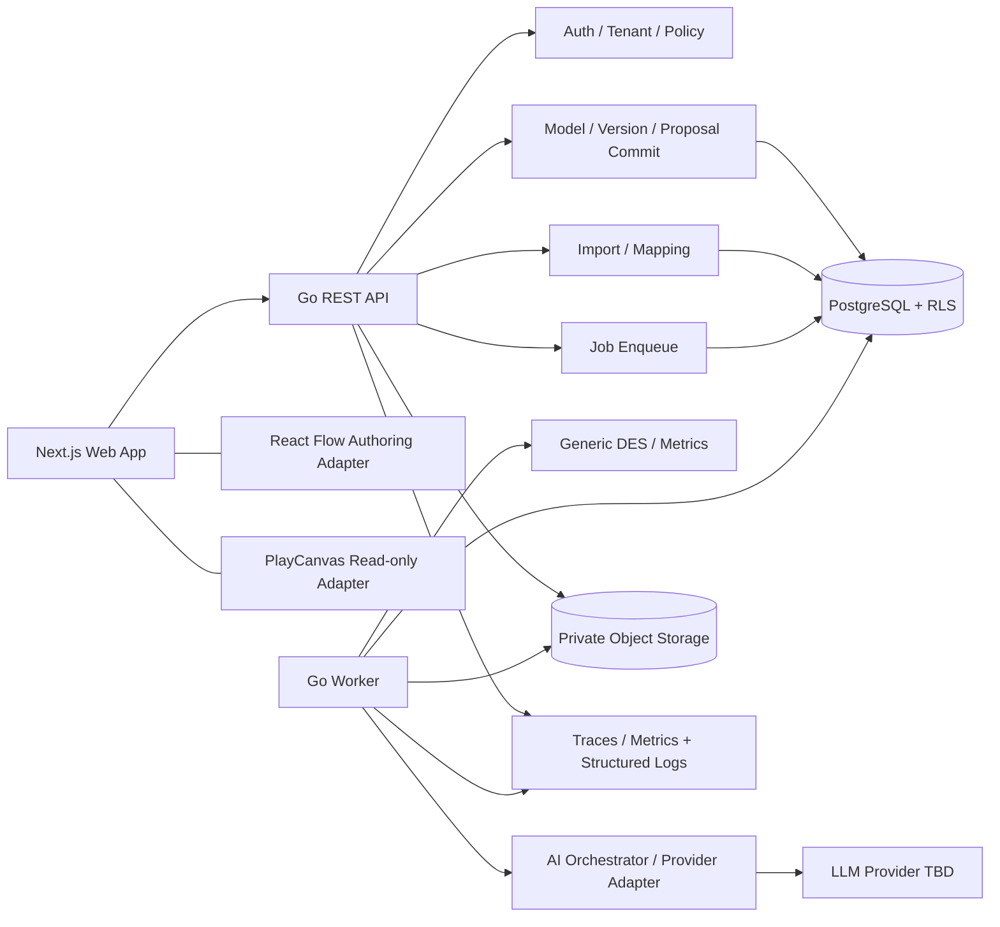

# Architecture & Module Responsibilities

SOURCE: original report pp. 8–14, 19–23, 27–28, 36–43, 49–53. The added transaction, worker isolation and interface parameters are engineering additions (D-003, D-006, D-008–D-013, all approved).

## 1. Runtime topology

A modular monolith + separate worker, matching the architecture diagram on page 8 of the original report. P0 does not split into multiple microservices.



Arrows are controlled calls; they do not mean the LLM can write back to the database. The API and the worker share pure domain packages, schemas and storage interfaces; runtime credentials and grants are separate. LLM SDK types must not appear in domain signatures.

## 2. Module responsibilities and forbidden dependencies

| Package / feature | Owns | Must not own |
|---|---|---|
| internal/auth | JWT verification, subject extraction, issuer/audience/expiry (T-008, ADR-017) | trusting a client role / choosing an arbitrary tenant |
| internal/tenant | membership, organization authorization, transaction context; `RunSelf`: a read-only transaction that sets only the user and selects no organization (D-045; RLS shows only the user's own memberships and their organizations); `me`: `GET /v1/me` (the user's own user ID and memberships); `memberships`: member management by the owner (T-010); `workerscope`: the worker runs in its assigned organization (no membership lookup; only the worker side may import it, T-019) | replacing authorization with a hidden UI button; authorizing with the role from `/me` |
| internal/project | tenant project lifecycle (T-009: create/list/get; idempotent create and audit in the same transaction) | handling IR or DES directly; writing its own SQL |
| internal/httpapi | HTTP transport (ADR-019): error envelope, request ID, schema-validated JSON body, token→`tenant.Scope` middleware (`Scoped`), `Self`, which only verifies the token and resolves the user (D-045; rejects `X-Organization-ID`) | business rules; taking a role from a header or body |
| internal/api | composes all routes into the handler that cmd/api and the integration tests share | business rules |
| internal/ids | D-001 IDs (`<prefix>_<ULID>`) | — |
| internal/model | IR types, validation, JSON Patch, hash, the integer tick arithmetic of the calendar's S(t) (`internal/model/calendar`, T-049: shared by the validator's R2, R4 and the engine) (generic kernel; depends on no storage, tenant or pack) | provider-specific prompts, renderer layout runtime |
| internal/models | model/draft/version service (T-012, ADR-022): create from template, draft CAS and issues, publish, reset, version advance rules (`Service.Advance`, also used by the T-026 approval); every write locks the model row first; HTTP adapter (T-013: If-Match/ETag, error mapping) | writing its own SQL; living inside the generic kernel |
| internal/domainpack | catalog, domain rules, event inference, domain metrics, prompt context, default views | requiring a change to the generic engine source to add a domain |
| internal/import | file profile, column map, row validation, frozen datasets, inference proposal. T-016: `upload` (service and HTTP adapter for upload, reads and the error report), `profile` (pure streaming CSV/JSON profile and preview), `report` (formula-safe error report), `profiler` (`import_profile` job handler, linked only by cmd/worker). T-017: `mapping` (pure mapping checks and the canonical event of each row), `validation` (pure full validation and streaming write of the canonical dataset), `validator` (`import_validate` job handler, linked only by cmd/worker), `upload/mapping.go` (the saveImportMapping service); commit belongs to T-018 | publishing a Twin directly without approval; `profile`, `report`, `mapping`, `validation` touching storage, tenant, HTTP or files (`import-parsing-is-pure`); any program other than cmd/worker linking `validator` (`job-handlers-only-in-the-worker`) |
| internal/ai | sanitized context, provider interface, typed outputs, validation orchestration (T-024, ADR-027 ACCEPTED (H-019): `aicontext` builds the sealed prompt, `provider` is the client and the fake/disabled/live modes, `provider/anthropic` is the only live adapter that links an LLM SDK, `idpool` (D-046), `locale` (REQ-022, number checks in prose), `corpus` (`make ai-eval` with the fake provider); T-025: `review` is the server's review of the provider's answer (patch, candidate validation, ID pool, pack, expected effects, server risk), pure functions; T-055 (ADR-030 PROPOSED): `provider/meta` is a second live adapter, for the Meta Model API (Muse Spark, SAM 3.1; standard library only; the two live adapters do not link each other: rules `live-adapters-apart` and `live-adapters-apart-anthropic` (review round 1 L5); a request with images is counted with count_tokens first and then reserved (H-037)), `provider/structured` is the projection and decoding that both adapters share, and `provider` also has images and `Segmenter`)) | holding a ModelCommitter, SQL handle or production tool directly; reading environment variables to get keys |
| internal/proposals | AI proposal service (T-025): create (role, idempotency, AI availability, whether the base is latest, a server-generated ID pool; enqueued in the same transaction as the `model_proposal` job and audit, 202), list, get; each status shows only the content it has (from T-026, decided statuses also carry the decider, time and comment, D-068 APPROVED, H-021); HTTP adapter in `http.go` | calling the provider; writing its own SQL; approve or reject (those are in `internal/proposals/approval`) |
| internal/proposals/approval | the human decision (T-026, D-067–D-069 APPROVED, H-021): service and HTTP adapter for approve/reject. One transaction: role, Idempotency-Key, then lock the model row, the draft and the proposal in that order (the order in §4); only a ready proposal can be approved; when the base is no longer latest, the proposal becomes conflicted and the call returns 409 (stored as that key's response); the stored content is reviewed again with `internal/ai/review` and the dataset binding stage is rerun (the stored validation, risk and hash are not trusted); edit creates exactly one version and applies the draft rules with `Service.Advance` of `internal/models`; scenario creates exactly one scenario; decision record, audit and idempotency response in the same transaction | calling the provider; being linked by the worker, a job handler, another service or `internal/ai` (rule `decisions-only-in-the-api`); writing its own SQL; auto-rebase |
| internal/scenarios | scenario service (T-028, D-078–D-080 APPROVED, H-022): scenarios created by people (createManualScenario: role, Idempotency-Key, any version of this organization (D-067), patch checks with the same rules as AI scenarios (`check`: `patch.Scenario` allowlist, full candidate validation, domain pack), the dataset binding stage run with the base's manifest, in the same transaction as exactly one scenario, audit and idempotency response); reads and lists of both kinds of scenario (created by people and created by approving an AI scenario); HTTP adapter in `http.go` | creating a version, changing a model or draft, enqueuing a run; writing its own SQL; being linked by the worker, a job handler, another service or `internal/ai` (rule `scenarios-only-in-the-api`) |
| internal/proposals/generator | `model_proposal` job handler (T-025, adapter; implements `internal/worker/handler.Handler`, linked only by cmd/worker): under the lease, reads the proposal and the base; outside the transaction, builds the context, reads and validates the base's dataset snapshots (before calling the provider), calls the provider, reviews, and runs the dataset binding stage with the snapshots already read; the result is written in the same transaction as the job's completion | living in `internal/ai`; writing a model, draft or version; waiting for the provider inside a transaction |
| internal/proposals/photo | photo intake (T-056, D-130 PROPOSED): detects PNG/JPEG from the start of the file, limits on bytes and pixels (the header is read first), an in-process limit on concurrent decodes, re-encoding in the same format after decoding (only the pixels are kept), comparing the bytes read back with the record | storing files, calling the provider, trusting the file name or the declared type |
| internal/storage/aispend | ledger of live AI spend (T-053, migration 0016; D-110, D-111 PROPOSED): implementation of `provider.Meter`; a reservation takes the deployment-wide month and day totals and the tenant's day total with conditional UPDATEs in the same lock order (the UTC day and month come from the database clock); settlement moves the same three totals and closes the reservation (spend above the reservation is recorded as it is and flagged); audit `ai_spend.*`, metric `geminus.ai.spend*` | being linked by the API (the API does not call the provider and has no grant); storing prompts, answers or keys; writing deployment-wide totals into a tenant's audit |
| internal/aievals | runner and command line of the live eval (T-053, D-114 PROPOSED; linked only by `cmd/ai-eval-live`): the same enabling conditions as the worker, otherwise no backend is built; metered against the run's own limits, which must fit within the deployment's daily limit and the daily and monthly amounts left in the spend record (`checks/ai-evals/live-spend.jsonl`, append-only); reports are written to `checks/ai-evals/live-*.json` and never overwritten (T-053 review round 1 H1) | building a live backend itself; storing prompts, answer text or keys in a report; writing to the fake result files |
| internal/secret | a secret string type that is never printed, logged or JSON-serialized (T-024; shared by config and the live adapter) | any business rule |
| internal/simulation | heap, clock, RNG, resource queues, routing, metrics; finite buffers and blocking (D-049) and `ErrDeadlock` of D-050 B1 (T-047, des-go-0.2.0); resource breakdowns (D-051, finish-first), lognormal and Weibull (D-056, pinned exp and AS241), `ErrStalled` of D-050 B2 (T-048, des-go-0.3.0); calendars (D-052, CAPACITY_CHANGE, a breakdown clock that runs on on-shift time, B2's next_fit and X_end) and release schedules (D-053) (T-049, des-go-0.4.0); batch processes (D-054, BATCH_TIMEOUT) and setups (D-055, unit identity) (T-050, des-go-0.5.0) | HTTP/DB/network, tenant discovery, UI; calling SimPy or any reference (`scripts/simpy_reference.py` only reads the engine's output, in tests) |
| internal/results | aggregation, comparison, evidence catalog, trace artifacts. T-029: `compare` is the pure baseline/scenario comparison (comparability, the absolute/relative delta of each statistic, baseline 0, missing values and incomparability, in a fixed order; D-088 APPROVED, H-024) and the metric paths an analysis can cite (`Statistics`, `Resolve`, RFC 6901, D-090 APPROVED, H-024), shared by the API and the later analysis job | the AI computing actual values that were not supplied; reading the DB or HTTP |
| internal/comparisons | service and HTTP adapter of compareSimulations (T-029, D-089 APPROVED, H-024): query checks; in one read-only REPEATABLE READ tenant transaction, the role, the two runs (404), readiness (409) and the two results (`internal/storage/runs`, organization filter plus RLS); after the transaction, computed with `internal/results/compare`; inconsistent results are 500 | computing deltas itself; writing any data or audit; writing its own SQL |
| internal/audit | catalogue of audit events (T-035, D-091 APPROVED, H-024): for each action, the actor kinds, target kinds, allowed metadata keys and value shapes (ID, hash, count, flag, code, closed enum, short label); `Check` is called by `internal/storage/auditlog` before writing, and a mismatch makes the write fail closed; `ValidActor` (worker/system actor, D-092 APPROVED, H-024) | raw prompts/secrets/chain-of-thought or any free-text metadata; I/O (rule `audit-catalogue-is-pure`) |
| internal/observability | structured logs (T-035, D-093, D-094 APPROVED, H-024): `NewLogger` (JSON lines on stderr), a `Handler` that filters every attribute by a registered key list and value shape (default deny; free text has credentials, e-mail addresses and quoted values removed, with a length limit), correlation carried in the context (`WithRequestID`, `With`, `Track`/`Annotate`). `telemetry`: spans and instruments recorded with the OTel API (D-095), no-op by default; `telemetry/export`: installs the SDK and the OTLP/HTTP exporter only when an OTLP endpoint is configured (ADR-028 ACCEPTED, H-024) | dependencies outside the standard library (`observability-is-a-leaf`); telemetry linking the SDK or an exporter (`telemetry-uses-the-api-only`, `otel-sdk-only-in-export`); being depended on by the kernel or `internal/ai` |
| internal/runs | simulation run service (T-023): after freezing the version/patch/config/datasets/engine/limits, enqueues in the same transaction as the job, audit and idempotency response (202); list/get/cancel; results; sampled trace streamed after authorization (D-044); SSE progress (membership and role rechecked before each event, TEST-026); HTTP adapter in `http.go` of the same package (as in internal/models) | writing its own SQL; executing the engine; trusting limits sent by the client |
| internal/runs/runner | simulation job handler (T-023; implements `internal/worker/handler.Handler`, registered only by cmd/worker): under the lease, reads the frozen input; outside the transaction, executes `internal/simulation/des`; grants event credit in batches through a durable reservation; checkpoints write progress and read cancellation; the result and trace metadata commit in the same transaction as the job's end | living in the generic kernel; cross-tenant scans; writing after the lease is lost |
| internal/storage | tenant-aware repos, object adapter, transactions; `auditlog` (audit append in the same transaction; user and worker events), `idempotency` (D-011), `projects`, `models` (models/drafts/versions and binding rows), `jobs` (queue, lease fence, retries, reaper, cancellation; T-019, ADR-024), `runs` (SQL for simulation_runs, run_datasets, simulation_results; T-023), `imports` (upload and profile of imports; T-016), `objects` (the minimal object storage interface of D-044 and a filesystem adapter for development/test only), `snapshots` (implements `datasets.Store` on object storage, so the binding stage itself touches neither the DB nor object I/O), `proposals` (SQL for ai_proposals; T-025; T-026 adds the decision writes for approve, reject, conflict), `scenarios` (insert and get of scenarios; T-026; T-028 adds list by version) | automatically treating an untrusted organization_id as authorization |
| internal/storage/migrations | runner that applies `migrations/` at deploy time (T-039, ADR-029 PROPOSED): accepts only a migration login that can act as twin_owner and is not a superuser or the runtime/provisioning login; each migration in the same transaction as its record in `geminus_migrations.applied`, an advisory lock, refusal when a record and its file differ; linked only by `cmd/migrate` (rule `migrations-only-in-their-command`) | being linked by the API, the worker or any runtime program; patching or rewriting an applied migration |
| internal/worker | job loop (T-019, ADR-024): reap and claim per organization, heartbeat, stopping the handler before the lease ends, recording attempt results; the `handler` subpackage is the handler interface (`Run`: `Job`, `Checkpoint`, `Finish`) and does not depend on the worker scope | business rules of handlers; cross-tenant scans or BYPASSRLS |
| cmd/api / cmd/worker | composition root, config, lifecycle; T-035: logs with `observability.NewLogger`; the API wraps `api.Handler` in `httpapi.AccessLog`; both decide whether to export with `config.LoadTelemetry` and `telemetry/export.Setup` (no export by default); T-039: opens object storage per config (filesystem or an S3-compatible bucket); besides the access log, the API serves the platform's `GET /healthz`, `GET /readyz` (not under `/v1`, no token needed), and `geminus-api -probe` is the image's health check | hiding business rules or a different validator version |
| cmd/migrate | the deployment's migration step (T-039): `up`/`status`; reads only `GEMINUS_MIGRATE_DATABASE_URL` | reading the runtime `DATABASE_URL`; running inside the API or worker process |
| apps/web/features | editor, import, proposals, simulations, results, 3D | a second topology, server authorization |

The T-056 photo path (H-033; D-130–D-132 PROPOSED) builds on T-055's names: `provider.Image` (`NewImage`, digest), `Prompt.Images`, `provider.Segmenter`/`SegmentClient`/`SegmentBackend` (fake, Disabled; the live SAM 3.1 is wired up by T-055); T-056 only adds `provider.Client.AcceptsImages` (so the generator knows whether the vision client accepts images before the segmenter spends money) and the fake matching a script by the digest of the first image. `domainpack.PhotoVocabulary` (the pack's concepts, implemented by the electronics line), `aicontext.ImageProposal` and `review.Photo`/`Segmentation` are all pure; HTTP and storage are in `internal/proposals` (`image.go`, `image_http.go`) and `internal/storage/proposals` (`InsertImage`; reads LEFT JOIN the image); the generator's `generatePhoto` is only in the worker; `Config.Vision` and `Config.Segmenter` are T-055's `deps.photo` (judge and segmenter, `AI_VISION_PROVIDER`); without them, a photo proposal fails with `AI_PROVIDER_NOT_CONFIGURED`.

## 3. Four stable contracts

**Model IR**: JSON + schemas/model-ir.schema.json; the only model interchange for the UI, AI, import, engine and future domains. React Flow nodes/edges are only a projection. From T-046 phase 2, the IR has ADR-026's optional line-flow members (TWIN_IR_SPEC §2.1); until the tasks that implement them (T-047–T-051), the primitive support stage of `internal/model/validate` and the kernel support list of `internal/simulation/engine` each reject models that use them with `PRIMITIVE_NOT_SUPPORTED` (D-063 APPROVED, H-019), so publish, scenarios, AI proposals and runs never treat them as absent. Both lists are in the generic kernel and depend on no pack.

**DomainPack** (keeps the original report's interface concept):

```go
type DomainPack interface {
    ID() string
    NodeCatalog() []NodeDefinition
    ResourceCatalog() []ResourceDefinition
    Validate(ModelIR) []ValidationIssue
    InferFromEvents(context.Context, CanonicalEventDataset) (*InferenceResult, error)
    ComputeMetrics(SimulationResult) map[string]Metric
    PromptContext() DomainPromptContext
    DefaultViews(ModelIR) ViewDefinitions
}
```

T-011 implementation (`internal/domainpack`): the interface keeps the methods above; the process registers packs explicitly in a `Registry`, and an unregistered domain returns `ErrUnsupportedDomain`. `InferFromEvents` of `SoftwareDeliveryDomainPack` returns `ErrUnavailable` before T-027 (it does not pretend to infer); `ComputeMetrics` marks all five DORA metrics unavailable, with a reason, when there is no approved deployment/failure/recovery mapping (D-010); `DefaultViews` keeps existing 2D positions and fills in the rest with a deterministic BFS-layered layout; the template used to create a model is the D-017 synthetic full pipeline (kept consistent with `testdata/golden-models/default-delivery.json` by tests).

T-042 implementation (boundary guard, test-only, not a second product domain): `internal/domainpack/conformance` is the DomainPack conformance suite; a pack's tests call `conformance.Run` with valid models of their own domain. It checks: the ID is a valid IR domain and stable; the catalogs use only generic node/resource types, kinds do not repeat, and copies are returned; `Validate` does not change the IR, is deterministic, and returns a `DOMAIN_MISMATCH` error for other domains and for nil (fail closed); `DefaultViews` returns 2D positions for this IR's node IDs only (no more, no fewer, no overlaps, existing positions kept, still valid when applied back to the IR; 3D is derived from 2D, with no separate topology); `ComputeMetrics` does not change the engine's Result, the generic metrics are unchanged, the Result passes the schema, and the digest is reproducible; `InferFromEvents` must return an error with no result for an empty dataset and for a cancelled context (it does not fabricate a model); with events, it may only return an error (with no result) or a valid model of its own domain, and the same dataset gives the same result twice (IDs are allocated by the server, D-016); `PromptContext` and the catalogs are static data: they are the same before the pack has seen any IR and after it has seen a model and events carrying a sentinel, and they do not contain the sentinel; the pack is stateless: after it has seen a sentinel model (the name and every ID carry the sentinel), its `Validate`, `DefaultViews` and `ComputeMetrics` answers for every model are unchanged; concurrent calls, including `ComputeMetrics` and `InferFromEvents`, give consistent results (data races are checked by `make backend-race`); the engine's generic metrics, seed and hashes do not change because of the pack. In addition, the same IR and its variants that each break a single rule (unknown flow target, duplicate ID, probability sum, no sink, bad triangular, metadata too deep, a failed constraint, zero-time cycle: at least one per validator stage) are renamed to an unrelated domain; the generic validator's issues must then be exactly the same, and the engine must run and give exactly the same numbers (the kernel does not read the domain, TEST-002). `softwaredelivery.Pack` and a generic queue pack that exists only in a test file (`generic_queue`, service counter) both pass. `scripts/check-architecture` (`make architecture-check`, CI backend job) checks transitive dependencies from the build graph of `go list -e -deps -test`; the graph is the union over 8 platforms (linux amd64/arm64/ppc64le/s390x/riscv64/loong64, darwin arm64, windows amd64) × cgo on/off; a file that no platform compiles (custom build tag) is itself a violation; every package of the `./...` module is checked (`go.mod` excludes `apps/web/node_modules` with `ignore`); a package that is imported but is not in `./...` (`testdata`, directories starting with `_`) is itself a violation: the generic kernel (`internal/model`, `internal/simulation`, `internal/results`, the `internal/domainpack` interface, `schemas`) depends on no domain pack, application layer, test helper, network/DB/process I/O, DB driver or LLM SDK; the only third-party code allowed is jcs, jsonschema and the packages of x/text that the message catalog links (`language`, `message/...`, `feature/plural`, `internal/...`); in the transitive dependencies of the kernel and the packs, module packages may only be kernel packages (and the pack's own unit), third-party packages may only be the allowlist above, the standard library packages imported directly may only be an allowlist of computation, encoding, hash and embed packages (`kernelStd`; it excludes `os`, `syscall`, `unsafe`, `io/ioutil`, `path/filepath`, `text/template` and other packages that touch files or the network underneath), and there may only be Go source files (no assembly, C or `.syso`). The import rules cannot see writes to stdout/stderr through `fmt.Print`/`log`/`print`, `time.LoadLocation` reading zoneinfo, or file access inside allowed third-party packages (jsonschema's `FileLoader`); these are covered by review and the determinism goldens; the kernel's tests also do not import concrete packs; a pack is a direct subpackage of `internal/domainpack`, builds only on the kernel, and packs do not depend on each other; a pack's subpackages may be imported only by the pack itself and must not depend on the DomainPack interface; this cannot guarantee one pack per package (a second pack type in the same package, or a generic pack in a subpackage, both pass), so at registration `domainpack.NewRegistry` requires that each pack's type is declared in its own direct subpackage, one pack per package; the conformance suite names no concrete pack; production code does not link `testing` or test helpers; LLM SDKs only in `internal/ai` (and cmd), DB drivers only in storage/tenant (and cmd), and storage's base layer `internal/storage/postgres` (which can open a connection with any connection string) also only in storage, tenant and cmd (`db-handles-only-in-gateways`, T-009 review); `internal/ai` must not obtain a SQL handle, storage, tenant scope or `os/exec` (this rule was marked future before the package existed; it is in force from T-024, see the T-024 paragraph under ModelChangeProposal in §3). Go cannot import frontend types; frontend LLM/DB imports are blocked by ESLint `no-restricted-imports` (`apps/web/tests/lint-guards.test.ts`).

T-051 hackathon slice (H-029; details D-117, PROPOSED): the P0 electronics line pack `internal/domainpack/electronicsline` (domain `electronics_line`) is registered by `internal/packs` together with the example pack; it reads the nodes' `domain_attributes` (`station`, `pass`, `result_of`, ELECTRONICS_LINE §3.3), and the generic kernel still does not read them. The metrics need the model (which processes are stations, the resources' roles, calendars, routing probabilities), so an optional `domainpack.ModelMetricsProvider` is added (`ComputeModelMetrics(ir, result)`, D-058 option A; the method set of `DomainPack` is unchanged): `des.Engine.ModelMetrics` calls it with a copy of the effective IR after `DomainMetrics` and before the digest, and writes `metrics.domain` (an empty answer is not written; other packs' Results and digests are unchanged); the runner wires it up for packs that have this interface; the conformance suite's `model-metrics/*` steps check that it does not change the IR or the Result, that keys are non-empty, that the Result passes the schema, that the generic part is unchanged, and that the answers through the engine and from a direct call are the same and reproducible, and they include it in the stateless and concurrency checks. The pack aggregates with `internal/results/metrics.Summarize`, the same numerical profile as the Result's other statistics; the FMA check of `make backend-numeric` covers `internal/domainpack` (the pack's metrics are in the digest).

T-052 hackathon slice (H-029; details D-118, PROPOSED): the vocabulary of an imported station log belongs to the pack (D-059), so an optional `domainpack.EventRulesProvider` is added (`EventRules(ir)` returns a data-quality check for a canonical event; its issues are warnings; the method set of `DomainPack` is unchanged). The pure validation of an import (`internal/import/validation.ValidateWith`) receives only a check function and does not know the pack; the validation job (`internal/import/validator`, linked only by cmd/worker) reads the version the import is bound to and finds the check among the packs the worker serves. The D-060 comparison has two layers: `internal/results/observed` is pure arithmetic in the generic kernel (simulated mean, replication range, absolute and relative error, no verdict); which quantities, which station and which window belong to the pack (`electronicsline.CompareObserved`). The synthetic data generator (`scripts/gen-electronics-line-data`) gets the template through `internal/packs` and records replications with the engine's Observer; it is not a second simulation.

**SimulationEngine** (the original report's interface):

```go
type SimulationEngine interface {
    Validate(context.Context, ModelIR) ([]ValidationIssue, error)
    Run(context.Context, ModelIR, RunConfig, ProgressSink) (*SimulationResult, error)
}
```

APPROVED D-006: before the call, the worker assembles an immutable `RunInput` that contains the ModelIR, the resolved empirical datasets, the dataset manifest, the effective model hash and the frozen config. The resolved dataset bindings may go in an internal-only field of RunConfig or in an explicit RunInput; **the pure engine must not query the DB/object storage in Run()**. T-003 must confirm the final encoding of the Go interface and must not hide a mutable global resolver.

**ModelChangeProposal**: the provider can only supply content; the server binds identity/base/mode/status/validation, and only human approval triggers the canonical commit. The schema separates provider output, stored proposal and approval response, so that a readOnly annotation is not treated as a security boundary.

T-024 implementation ([ADR-027](adr/ADR-027-ai-provider-adapter.md), ACCEPTED, H-019): AI calls have three layers. `internal/ai/aicontext` builds the prompt from data that the caller has already read in the tenant scope (it does not touch the DB): input from another organization or model is always rejected (typed error, no silent filtering); credentials, URLs, emails, IPs, D-001 server IDs and invisible characters are masked first; strings, row counts and summaries have limits; when the budget is exceeded, items are omitted in order and the omissions are written to `CONTEXT_OMISSIONS`; server rules are in the system text, and user and import data appear only inside an `<untrusted_data>` block (content HTML-escaped, so a block cannot be forged); domain text comes only from the DomainPack's `PromptContext`, and the package itself contains no domain nouns. The `Client` of `internal/ai/provider` checks the prompt's hash, role, organization and size before calling the backend, limits concurrency and timeout per organization, validates the answer against the schema before a strict decode, and keeps only a path and a fixed message for errors; the modes are `disabled` (default; returns `provider_not_configured`/`policy_not_approved`), `fake` (development/test only) and `anthropic` (live). `internal/ai/provider/anthropic` is the only package that links an LLM SDK: keys are injected explicitly by config, not read from environment variables; per D-018, it moves to the next key only on 401/402/403, and retries 429/529/5xx only on the same key; rule `ai-is-pure-but-the-adapter` lets the other packages of `internal/ai` use only the kernel's standard library and third-party allowlist (no network, files, DB or processes), and `ai-suggests-only` forbids all of `internal/ai` from depending on storage, tenant, DB drivers, `database/sql`, the application layer and `os/exec`. A proposal's ID allocation pool (D-046) is stored in `ai_proposals.id_pool` (migration 0011; immutable after creation). Live AI is still off: config accepts `AI_PROVIDER=anthropic` only under an approval that the owner has registered, and the register (leaf package `internal/config/aiapproval`) is empty (H-017); the adapter accepts only an `Approval` token that only that package can produce, and `ai-suggests-only` lets `internal/ai` depend only on this leaf of `internal/config` (review L5).

T-053 implementation (D-110–D-115 PROPOSED): `aiapproval` records the full content of H-018 (model, data policy, budget, credentials, approver and date, confirmation of the Console spend limit), and a token is produced only from a record whose `Gap` is empty; H-018 has been complete since the owner confirmed the data retention arrangement (H-026: standard, no ZDR, the same for both), and live turns on only when `AI_MODEL`, both keys and `GEMINUS_AI_LIVE=on` are all set. Spend has three layers: `internal/ai/spend` (pure computation: fixed list prices, cost, attempt limits, periods); `Billable`/`Meter`/`NewMetered` of `provider` (the client reserves before the call, does not call when the reservation is refused, and settles after the call; the live adapters can be called only through a metered client); `internal/storage/aispend` (the PostgreSQL ledger, migration 0016, implementation of `provider.Meter`, executed in worker-scope transactions, assembled by cmd/worker). The new rule `live-ai-only-in-the-worker` lets only the adapter itself, `cmd/worker` and `cmd/ai-eval-live` link the live adapters (probes: cmd/api, generator, aispend); `live-eval-only-in-its-command` lets only `cmd/ai-eval-live` link `internal/aievals` (the live eval runner; probes: cmd/worker, internal/models); `internal/aievals` is listed in the application layer.

## 4. Model / draft / version / scenario lifecycle

Create builds the model, a valid template v1 and the draft revision=1/base=v1 in a single DB transaction. The draft can change, but every mutation carries If-Match. Publish locks the model row, checks base/latest and revision, creates a parent-linked version and syncs the draft. Version content is never UPDATEd.

APPROVED D-003: the lock order of approval is model → draft → proposal → idempotency completion (the idempotency reservation is made first, but it must not create a reverse lock order with other operations). Authorization and the key reservation complete first; then the consistent domain lock order runs. If the draft content is identical to its base and base=latest, the draft can be synced to the new version and its revision incremented; a dirty draft is not touched, and the response has `draft_out_of_date=true`. The next publish of a stale draft must handle it explicitly; there is no silent rebase.

T-026 implementation (`internal/proposals/approval`): approve and reject both run `LockModel`, `LockDraft` and the proposal lock, in that order, after the membership `FOR SHARE` (`tenant.DB.Run`) and the Idempotency-Key claim, so approvals, rejections, publishes and draft edits of the same model take turns; the worker locks only the job and then the generating proposal, never the model, so there is no reverse order. The draft rules share `Service.Advance` of `internal/models` with publish (clean is judged against the draft's own base, T-012 review L3). Approving a scenario does not touch the model, draft or version.

A scenario is the immutable experiment description of a ModelVersion + an ordered JSON Patch. AI scenario approval writes a scenario, not a ModelVersion; a run freezes the patch at enqueue and takes no data from a mutable scenario/config.

T-028 implementation (`internal/scenarios`): people can also create a scenario on any version of this organization (not only latest, D-067); the patch follows the same rules as AI scenarios (D-021: the `patch.Scenario` allowlist and test-before-modify, full candidate validation, domain pack, then the dataset binding stage with the base's manifest). Creating a scenario does not change the model, draft or version, so it does not lock the model row or enqueue any job. Reads and lists cover both kinds of scenario, told apart by `source_proposal_id` (null for scenarios created by people).

## 5. Request / transaction boundary

APPROVED D-008: the order of every tenant request is verify JWT → get subject → begin transaction → SET LOCAL organization_id/user_id → look up membership → role check → scoped query + RLS. X-Organization-ID is only a tenant selector; the header carries no trusted role. A resource's org must match its URL parent; IDs of another tenant return not found, without revealing that they exist.

Never wait for the LLM or run DES inside a DB transaction. Enqueue: inside the transaction, create resource/status + job + audit + idempotency response → commit → 202. The worker reads a snapshot, commits the claim → executes outside the transaction → commits the result in a lease-fenced transaction.

## 6. Queue / storage / isolation

PostgreSQL jobs use `FOR UPDATE SKIP LOCKED`; P0 adds no broker. APPROVED D-008: the worker polls only the organization allowlist that the deployment assigns, and sets a transaction-local context per tenant; **there is no unrestricted cross-tenant jobs SELECT, and BYPASSRLS is not granted**. If a dispatcher is needed later, design a least-privilege interface in a separate ADR; do not slip a security-definer global scanner into the worker.

T-019 implementation ([ADR-024](adr/ADR-024-job-queue-and-worker.md), ACCEPTED, H-010): `internal/storage/jobs` is the queue (enqueue in the same transaction as the resource and audit; claim by priority/created_at/id, `SKIP LOCKED`; heartbeat, lock, complete, cancel and fail fenced by organization, job, worker and lease token; retries with bounded backoff; a reaper that recovers expired leases organization by organization; queued jobs are cancelled immediately); migration 0007 enforces the job lifecycle in the DB (terminal states cannot change, identity and input cannot change, attempts and tokens never go back, a queued job always has an attempt left) and limits each runtime role to its own step (the API can only enqueue, cancel or requeue a queued job; from queued, the worker can only claim; a running job can only renew its own lease, which is cleared when the job leaves running; all other roles are refused). `internal/tenant/workerscope` is the only worker scope, and only `cmd/worker` and `internal/worker` may depend on it (architecture rule `worker-scope-only-in-the-worker`). `internal/worker` is the loop: each pass walks `WORKER_ORGANIZATION_IDS` in order; for each organization, after the reap, it runs at most one job; from the claim onward, each heartbeat renews in sequence (at most one heartbeat at a time), and the attempt stops before the DB lease ends (the lease minus half a heartbeat, counted from the start of the last successful renewal) or when the lease is lost; after the stop, the handler's transaction does not commit, and one in progress is cancelled and rolled back (the call returns the reason for the stop and wraps `fn`'s error); the only exception is a COMMIT already sent: whether or not the DB commits afterward, the handler gets `tenant.ErrOutcomeUnknown` (it may have committed). Handlers implement the leaf package `internal/worker/handler` (which does not depend on the worker scope), read and write under the lease with `Checkpoint`, and with `Finish` commit the result together with the job's end (completed or cancelled); handlers read and write the DB, so they are adapters and are not placed in the generic kernel or in `internal/ai`. `cmd/worker` only assembles config, connections (worker runtime role check and pool guard) and lifecycle; from T-023 it registers the simulation handler (`internal/runs/runner`), from T-016 the import profile handler (`internal/import/profiler`); the import validation and AI handlers belong to T-017 and T-025; a build with no handler still refuses to start, with exit 2.

T-016 implementation: in the API (`internal/import/upload`), an upload is authorized before the body is read, streamed into object storage, and enqueued in the same transaction as the `import_profile` job and audit; the profile runs in the worker (`internal/import/profiler`) under the lease, checks size and SHA-256 when it reads the object, parses and computes statistics outside the transaction, and commits the result together with the job's completed. Parsing and the error report are pure packages (`internal/import/profile`, `internal/import/report`: they only read and write bytes); rule `import-parsing-is-pure` forbids them from depending on storage, tenant, HTTP, DB, files or processes; rule `job-handlers-only-in-the-worker` likewise lets only `cmd/worker` link `internal/import/profiler` (probes: cmd/api, internal/import/upload). Neither upload nor profile touches the model, draft or version (D-009). Parsing memory does not grow with the file: one CSV record or one JSON event is at most 1 MiB, enforced while reading (T-016 review H1); an import's status is recorded only in its own row; when the profile job fails or is cancelled, a trigger of migration 0010 moves the import to FAILED with it (review M1), and the API does not derive it at read time.

T-023 implementation (package names decided by this task): `internal/simulation/service` and `internal/simulation/http`, originally planned in tasks.json, would fall under the generic kernel, and the kernel rules forbid DB, HTTP, tenant and storage dependencies (§3 T-042 paragraph, T-019 round 2 L3), so they became `internal/runs` (service and HTTP adapter, following `internal/models`), `internal/runs/runner` (job handler, adapter) and `internal/storage/runs` (SQL). `scripts/check-architecture` lists `internal/runs/...` and `internal/worker/...` as application layer, and the kernel and packs must not depend on them. The domain packs that the deployment serves are listed only once, in `internal/packs` (`packs.Registry`); the API (`internal/api`) and the worker (`cmd/worker`) both build their registry from it; rule `packs-named-in-one-place` forbids other production packages from naming a concrete pack, and `TestTheWorkerServesTheAPIsPacks` of `cmd/worker` compares the simulation handlers the worker registers with the domains the API serves (T-023 review L2: otherwise a run that the API accepts would fail permanently in the worker with `RUN_INPUT_INVALID`). Rule `job-handlers-only-in-the-worker` lets only `cmd/worker` link `internal/runs/runner`: neither the API nor the service it shares can, so no request can execute the engine or write as the worker (probes: cmd/api, internal/models). A run's status follows its job: the `follow_simulation_job` trigger of migration 0009 brings the run to the same status when the job returns to queued, failed or cancelled (failures recorded by the worker loop and by the reaper both go through it, so T-019's code did not need to change); a run's completed can only be written by `Finish`, holding the lease, together with the result; `protect_run_lifecycle` limits by role who can take which step (the API can only request cancellation, the worker can only start and complete, and the trigger follows for the rest); for any role (including owner), queued/failed/cancelled can only be brought about by the job, and completed only in the same transaction as the job's completed (T-023 review L1: otherwise the reaper would block the whole organization). The API's cancel and the worker's finalize both lock the job before the run (the order of ADR-024), so the two take turns and the latter sees the former's result.

T-025 implementation (package names decided by this task): tasks.json originally planned `internal/ai/proposals/`. But the handler reads and writes the DB, and `ai-suggests-only` forbids `internal/ai` from depending on storage and tenant, so it was split into four packages. `internal/ai/review` is the pure server review (together with `ID_POOL_VIOLATION`, `AI_OUTPUT_INVALID` in `internal/ai/review/codes.go`). `internal/proposals` is the service and HTTP adapter (the same approach as `internal/runs`). `internal/proposals/generator` is the job handler (adapter, the same as `internal/runs/runner`). `internal/storage/proposals` is the SQL. `scripts/check-architecture` lists `internal/proposals/...` as application layer; `job-handlers-only-in-the-worker` lets only cmd/worker link the generator (probes: cmd/api, internal/runs; if internal/proposals linked it, the generator's tests would form an import cycle, so it could not compile at all). Other probes confirm that review does not depend on the service, storage or files, and that the kernel does not depend on the service. A proposal follows its job (migration 0012, D-062 APPROVED, H-019). `protect_proposal_lifecycle` limits which role can take which step: the API can create only while `generating` and cannot change it afterward; the worker can write `generating` as `ready`/`needs_input`/`invalid` only in the same transaction as the job's completion (deferred constraint trigger `proposal_generated_with_its_job`). When the job fails or is cancelled, `follow_proposal_job` moves the proposal to `failed`, carrying the job's failure. The provider call, review and dataset binding all happen outside the transaction. In Finish, the handler locks the proposal again and writes only after confirming it is still `generating`. A provider error becomes the job failure with a fixed message; retryable errors are governed by ADR-024's attempt limit (D-061 APPROVED, H-019). Config decides the AI mode of both the API and the worker: fake only in development/test; live needs an approval that the owner has registered, and the list is currently empty; in all other cases the API returns 503 and the worker fails the job with a Disabled client.

T-026 implementation (package names decided by this task): tasks.json originally planned `internal/model/approval/`, but `internal/model` is the generic kernel (§3: no dependency on storage, tenant, DB or HTTP), while approval reads and writes the DB and calls the model service and storage, so it is an adapter; it became `internal/proposals/approval` (service and HTTP adapter, the same as `internal/proposals` and `internal/runs`; `internal/proposals/...` is already listed as application layer). The SQL is in `internal/storage/proposals` (`Approve`, `Reject`, `Conflict`), `internal/storage/scenarios` (new) and `internal/storage/models` (`LockDraft`). It is not placed in `internal/proposals` because it links the model service (`internal/models`), and a rule can then limit on its own who links it: `decisions-only-in-the-api` lets only `cmd/api` and `internal/api` link it, so the worker, job handlers, other services and `internal/ai` cannot approve (probes: cmd/worker, internal/runs/runner, internal/runs, internal/ai/aicontext; `internal/proposals`, `internal/models` and `internal/ai/review` are imported by approval, so linking back would form an import cycle and could not compile at all). Revalidation calls `internal/ai/review.Review`, a pure function, and `ai-suggests-only` still forbids `internal/ai` from depending on approval. Migration 0013 requires in the DB that a version or scenario whose source is a proposal is, at commit, that approved proposal's own effect (D-069 (e) APPROVED, H-021).

T-028 implementation (package names decided by this task): tasks.json originally planned `internal/model/scenarios/` and `internal/ai/scenario/`. The former falls under the generic kernel, while creating a scenario reads and writes the DB, calls storage and serves HTTP, so it is an adapter; it became `internal/scenarios` (service and HTTP adapter, the same as `internal/runs` and `internal/proposals`), listed in the application layer of `scripts/check-architecture`; the pure scenario patch rules were already in the kernel's `internal/model/patch` (`Scenario` mode, shared by createSimulation and the AI review), and `internal/scenarios/check.go` only combines them with full validation and the domain pack (it does not touch the DB). The latter is not needed: the AI scenario mode is already T-025's `internal/ai/aicontext`/`review` and T-026's approval; this task added no AI code, and `TestTheAIScenarioModeTakesTheSameRules` shows that manual and AI scenarios accept and reject the same patches (D-021). The SQL is in `internal/storage/scenarios` (adds `List`). The new rule `scenarios-only-in-the-api` lets only `cmd/api` and `internal/api` link it (probes: cmd/worker, internal/proposals/generator, internal/runs, internal/proposals/approval, internal/ai/aicontext; the kernel probe is in internal/results/metrics). Migration 0015 lets the API create a scenario only for the transaction's user and at the transaction's time, and adds an index for lists (D-080 APPROVED, H-022).

T-029 implementation (package names decided by this task): tasks.json originally planned `internal/results/http/`, but `./internal/results/...` is the generic kernel (§3; the architecture rule generic-kernel forbids HTTP, tenant and storage), so it was split in two: the pure comparison is in `internal/results/compare` (kernel; depends only on `internal/model`, `internal/model/hashing`, `internal/simulation` and the standard library; T-030's analysis job in the worker can call the same `compare.Compare` directly), and the service and HTTP adapter are in `internal/comparisons` (listed in the application layer of `scripts/check-architecture`, the same as `internal/runs` and `internal/scenarios`; probes: compare reading storage, tenant, net/http; the kernel's internal/results/metrics and internal/ai/aicontext linking internal/comparisons). No new SQL (`Get`, `GetResult` of `internal/storage/runs`), no migration, no audit writes.

Budget semantics (D-007's "durable budget reservations, bounded credit batches"): the wall clock counts from the run's first start (`execution_deadline_at`, not reset by retries), and each attempt gets only the time left; events are reserved before they are used: an attempt reserves the first batch when it starts, and when the engine needs more it asks for the next batch with `engine.Credit` (by default one tenth of max_events per batch); each batch can be used only after it is written under the lease to `event_budget_reserved` (it only increases and never exceeds max_events). Events reserved by earlier attempts always count as used, so a crash wastes at most the unused part of the last batch, and the events the whole run uses never exceed max_events. The engine sees only the granted credit and the context; it does not read the DB.

Large files and trace/result artifacts go in private object storage; the DB holds the metadata, hash, organization_id and authorized object key. A client can hold only resource IDs and cannot send an arbitrary bucket/key/url for the server to read. Empirical datasets are downloaded before compilation, hash-checked, unit-converted and frozen; losing the network during a run does not affect the pure DES. The D-044 interface is in `internal/storage/objects` (`Store`: Put computes SHA-256 and size and does not overwrite an existing key; Get; `Maintainer.Delete` only for controlled maintenance); `FS` is a filesystem adapter for development/test only (`OBJECT_STORAGE_PROVIDER=filesystem` is accepted only when `APP_ENV` is development or test; production refuses to start); `S3` (T-039, ADR-029 PROPOSED) is an S3-compatible private bucket (`OBJECT_STORAGE_PROVIDER=s3`, any `APP_ENV`): it likewise accepts only server-generated keys; Put stages the body first, signs with SHA-256 (SigV4, standard library) and writes with `If-None-Match: *`, so an existing object is never replaced; it issues no presigned URLs and follows no redirects, and the bucket's own timeout is not treated as the end of the request (T-054 I1); other providers are not implemented. cmd/api and cmd/worker build the same store from config; without one, a run that needs it (one that binds a dataset or records a sampled trace) returns 503 at enqueue, rather than failing after it is enqueued. A trace's key is `tenant/<org>/simulation-results/<run>/<artifact>.json`, a new key per attempt, so a retry never overwrites an existing object; an orphan object left when the upload succeeds but the commit fails is cleaned up by later maintenance (not yet implemented).

## 7. Frontend adapters

Server state (versions, proposals, jobs) is kept separate from unsaved draft/editor state (T-014's implementation is in ADR-016: `apps/web/lib/api` is the only HTTP exit, `lib/state/draft.ts` separates remote/in-flight/unsaved, and a 409 keeps local edits without auto-rebase). The ViewAdapter builds React Flow nodes/edges from IR IDs; 2D positions are view data, not domain semantics. The T-015 (hackathon slice) implementation is in `apps/web/features/model-editor/`: `flow.ts` produces nodes/edges from the working IR (the saved draft + the ops waiting to be saved), and when a position is missing it uses the same rule as `domainpack.LayeredLayout`; every edit is a JSON Patch produced by `edits.ts` (it first `test`s the element's identity, D-020), queued by the draft session and saved with If-Match; `testdata/editor/patch-vectors.json` lets `internal/model/patch` apply the same ops under the server's manual-draft policy and compare the model hash. The T-031 (hackathon slice) AI proposal review is in `apps/web/features/ai-proposals/`: the request on the model page only calls createProposal, and the proposal page (`/proposals/<id>`) shows only the server's proposal, base version and model; `changes.ts` reads the proposal's canonical changes op by op against the base version into changes a person can understand (not a second model); approve and reject are pressed only by a person and, after confirmation in place, call approveProposal/rejectProposal, after which the proposal and the model are read again; AI text is always rendered as text (review round 1: names and values in a patch each go in their own `<bdi>`, invisible and bidirectional control characters are shown as ⟨U+XXXX⟩, and entities with the same name or newly added ones carry their ID, `shown.ts`, `words.tsx`). 3D derives topology and layout and cannot write back to the graph; the same selectedEntityId store supports switching renderers. The playback loader is separate from aggregate results and can fetch an authorized sampled trace on demand.

The browser session uses a BFF (ADR-018): the Next.js server side holds the OIDC client and the tokens; the browser calls only same-origin `/api/v1/...`, which the BFF turns into a Bearer for the Go API; the Go API does not read cookies. Language (REQ-022, T-044): UI strings come only from the `en` (default) and `zh-Hant` catalogs; the language preference is stored in a cookie (no sensitive data, no effect on authorization); the API returns only language-neutral error codes and English developer messages, and the UI displays them by code; names, labels and dataset content entered by users are data and are not translated; the default names when a template is created follow the creator's language (the domain pack supplies names in both languages; IDs do not change). T-044's implementation is in ADR-020 (ACCEPTED, H-006): a hand-written typed catalog (`apps/web/messages/`, with zh-Hant typed to match the en keys) and `apps/web/lib/i18n/` (interpolation, Intl plurals/dates/numbers/durations); the cookie `geminus_locale` stores only `en`/`zh-Hant`; the root layout reads it on the server and sets `<html lang>`; routes have no language prefix; server messages and the reasons for unknown validation codes are shown as technical details with `lang="en"`; ESLint blocks hard-coded user-visible strings in `.tsx` (limits in ADR-020). Templates go through the optional `domainpack.TemplateProvider` (the method set of `DomainPack` is unchanged), and the conformance suite's `templates` step checks that each locale produces the same model, differing only in names.

AI review must show the base version, the candidate effective diff, server-computed risk, assumptions and validation. The UI copy of scenario approval and of publish must not be confusable. Every pending/needs_input/invalid/conflicted state has a clear next step; a provider timeout is never shown as an empty-patch success.

## 8. Deployment / observability / failure modes

T-035 implementation (D-091–D-095, ADR-028, all APPROVED, H-024): **Audit**: every business write (the catalogue of `internal/audit`) writes exactly one event in the same transaction; `internal/storage/auditlog` checks it against the catalogue first (a mismatch rolls back the whole write) and is the only program that writes `twin.audit_events` (provisioning also goes through it); the worker loop writes `job.attempt_failed` in the transaction that records the failure, and the reaper in the reap transaction (the job's resource and the request that created it). **Log**: JSON lines on stderr; every attribute passes the `internal/observability` filter (default-deny key list and value shapes; free text has credentials, e-mail addresses and quoted values removed); every line of a request carries `request_id`, and after resolution also `organization_id` and `user_id`; every line of a job carries the organization, job, type, attempt, resource ID and the request that created it; one access-log line per request (route pattern; the path and query are not logged). A panic logs only the type, or the runtime error's message, and the stack. **Traces/metrics**: OpenTelemetry (the API in `internal/observability/telemetry`, the SDK only in `telemetry/export`); nothing is sent when no OTLP endpoint is configured; metric attributes are low-cardinality and carry no IDs. Operational metrics are also recorded as logs (job, simulation, LLM, import, HTTP).

Deployment units: web, api, worker, managed PostgreSQL, object storage, OTLP backend. cloud/provider/retention TBD; Cloud Run is only the original report's reference and is not written into domain code. T-039 (hackathon slice, ADR-029 PROPOSED, [deploy runbook](runbooks/deploy.md)): three vendor-neutral images (`Dockerfile.api`, `Dockerfile.worker`, `apps/web/Dockerfile`; digest pin, non-root, no build arguments or credentials), a separate migration step (`cmd/migrate`, migration login), an S3-compatible object storage adapter (`internal/storage/objects/s3.go`: SigV4, conditional PUT, private), a local staging composition (`deploy/local/`, with a test OIDC provider, local only) and the Railway configuration that the owner chose (`deploy/railway/`, H-031: Railway only; `deploy.sh` applies it non-interactively with a pinned Railway CLI, H-032); the vendor appears only in `deploy/railway/` and the runbook, not in any Go or TypeScript code. Structured JSON logs + trace correlation; do not rely on the original report's time-bound statements about specific SDK versions.

Provider fail: proposal/analysis failed, no mutation. DB commit fail: no successful 202/201 is returned. Worker crash: the lease is recovered, retry with the same frozen input. Artifact upload succeeds but the DB commit fails: no visible completed result; the orphan artifact is cleaned up by the retention policy. Stale lease worker: cannot finalize. Cancellation: no completed metrics after the checkpoint; the analyst does not treat partial debug state as final results.

## 9. Conditions for architecture evolution

Keep the original report's triggers: benchmark a Rust prototype only when representative models exceed the SLO, profiling shows that >60% of runtime is DES compute, and changes to algorithms and data structures still do not help. Introducing a broker depends on measured queue latency / sustained throughput / cross-region / fanout; it must not be introduced first out of preference. Tests of a second domain prove the generic boundary with a minimal test pack; this does not mean P0 must deliver manufacturing.
