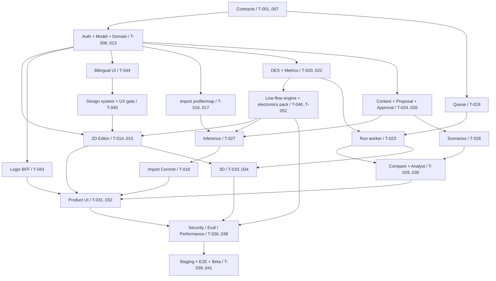

# Implementation Plan / Dependency Graph / Definition of Done

SOURCE: the original report pp.47–50. Four engineers / 16 weeks is the baseline, and weeks 17–20 are the risk buffer; with 3 people it may approach 18–20 weeks. The task breakdown, dependencies and DoD below are a candidate engineering plan, not agent effort estimated by the original report.

## 1. Development order

First fix the Model IR schema → Go domain types → validators → versioning → DES → API → React Flow → AI proposal → results → 3D. The base schema/DB/auth/CI and the frontend shell can proceed in parallel; do not finish a fancy UI first and then retrofit three different models.

`planning/tasks.json` is the machine-readable task source, with 42 tasks, all not_started. It contains depends_on, requirement_ids, decision_gates, scope, planned_outputs, acceptance_tests, verification_commands, definition_of_done, completion_evidence. Task numbers are not the schedule order; for example, T-018 depends on proposal/inference interfaces with later numbers, so tasks must be chosen by the DAG.

## 2. Milestones and dependency backbone

H-016 (2026-10-19, [ADR-025](adr/ADR-025-p0-domain-electronics-line.md)): the P0 domain changes to an electronics assembly/test line. T-046 first sets the domain spec, the ADR for the new core primitives and the PROPOSED decisions (no implementation before owner approval); T-047–T-050 change the same kernel in sequence (finite buffers and blocking, failures, shift calendars and arrivals, batches), one at a time, each with a differential showing "results identical to the current kernel when the new feature is not used"; T-051 builds the pack, and T-052 generates synthetic data and does the simulation/observation comparison. The near-term goal (initial product + technical validation, apply to a launchpad) corresponds to Product Alpha; the original 16-week estimate predates H-016, and the added work has not been re-estimated in weeks. Domain-independent tasks from T-023 and T-024 onward keep the original order.

The T-035 audit/observability baseline should be wired in from the first write/job, with full hardening in Week12–14; tenant safety is not something added only in week 12. T-042 is a test-only generic boundary guard, not a second customer domain added to P0. T-043 (BFF login, ADR-018) and T-044 (en default + zh-Hant, REQ-022) were added on 2026-10-18 per owner decisions (H-004, H-005); T-044 is completed before T-015, and every later UI task goes through the catalog.

## 3. Work allocation and weekly schedule

| Workstream | Main tasks | Alignment with the original report's schedule |
|---|---|---|
| Platform | bootstrap, DB/RLS/auth/projects, versioning, queue, run API, audit/deploy | Week1–8; Week12–16 hardening |
| Simulation | IR/semantic/hash, DomainPack, DES, metrics, differential/benchmark | Week1–8; Week13–15 validation |
| Frontend | app, 2D, import/review/results UI, 3D/playback | Week3–12 |
| AI / Full-stack | import/profile/map, provider/context, proposal/inference, analyst/evals | Week4–12; Week13–15 eval |

security/RLS/contract tests start with every slice; the source's Week12–14 is the overall hardening window. All dependencies are listed explicitly in tasks.json; a natural-language weekly schedule does not replace them.

## 4. Conditions for starting a task

Dependencies are complete, with evidence; required decisions have been confirmed by a human, or this task explicitly does only a spike/contract review; the source/spec has been read; expected errors and negative cases can be listed; this round's scope can be accepted. "The agent can do it all at once" is not a reason to cross an undefined contract.

The first pass does only T-001/T-002. Then T-003/T-004; verify the contracts/validator before persistence/model lifecycle. Frontend and backend can work in parallel against an approved contract; mocks must be explicitly labeled and must not be used to pass production gates.

## 5. Task completion / PR DoD

When each task completes: submit real functionality and tests, mapped to requirement/test IDs; run verification_commands and attach the exit code/result; keep schema/OpenAPI/DB/SDK aligned; record concurrency/security/rollback impact; error paths are reproducible; no secrets/raw customer data; no unauthorized P1 work. completion_evidence records the commit, test artifacts and the decision reviewer; never modify a source fixture to make an error look like a pass.

not_started→in_progress→blocked/review→done are planning states. blocked must state the missing dependency/decision/test environment. Acceptance requires real runs; anything not run is marked NOT RUN; a "not yet implemented" command in the Makefile must not be changed to echo success.

## 6. Milestone DoD

Alpha: manual model→immutable version→simulation→results, reproduced on a fixed fixture. AI Alpha: intent→ready proposal→human approve→exactly one version; reject/stale/double-approve tests all pass. Product Alpha: CSV→mapping→dataset commit→inference proposal→approval→scenario→run→compare→analysis, including 2D/3D and audit. Private Beta: real external team data, repeated what-if decisions and evidence of decision usefulness; retention/residency/provider policy settled.

A Beta release must meet docs/TEST_PLAN's gates, backup/restore, runtime privilege and production human approval at the same time. When the original report's engineering thresholds are not met, only record it and ask a human to adjust; never declare them met.

## 7. Delivery risks and handling

Late IR/Schema changes propagate to AI/UI/engine/DB: approve D-001/D-014 and contract tests first. Inconsistent DES semantics: approve D-005/D-006 and the goldens first, and fix the numeric profile. Insufficient AI quality: complete the flow with the fake first, but keep live capability blocked; high confidence must not bypass review. dirty draft/Scenario/import commit ambiguity: adopt D-003/D-004/D-009 or record an alternative, and update the four contracts together.

If 3D takes too long, reduce polish; do not drop the P0 viewer, and do not expand it into authoring. If performance is insufficient, profile/improve the algorithm first; benchmark Rust only when the original report's trigger is met. If the external provider/retention stays undecided, synthetic staging is allowed, but real customer data must never be sent quietly to an arbitrary service.

## 8. Per-task summary

The scope, commands and DoD of each task are in tasks.json.

- **T-001 — Source inventory, decision review and implementation boundary**: Platform + Product; Week 1; depends on none.
- **T-002 — Repository, toolchain, CI skeleton**: Platform; Week 1–2; depends on T-001.
- **T-003 — Freeze candidate contracts and Go/TypeScript domain types**: Platform + Simulation; Week 1–2; depends on T-001, T-002.
- **T-004 — IR / patch semantic validator**: Simulation; Week 2–3; depends on T-003.
- **T-005 — JCS/hash, frozen dataset manifest**: Platform + Simulation; Week 2–3; depends on T-003.
- **T-006 — Core migration and repository foundation**: Platform; Week 1–3; depends on T-003.
- **T-007 — RLS, runtime roles, pool isolation**: Platform; Week 2–3; depends on T-006.
- **T-008 — OIDC/JWT authentication**: Platform; Week 2–3; depends on T-002, T-007.
- **T-009 — Project service and server RBAC**: Platform; Week 3; depends on T-008, T-007, T-003.
- **T-010 — Controlled onboarding / membership management**: Platform; Week 3–4; depends on T-008, T-009.
- **T-011 — SoftwareDeliveryDomainPack / full template**: Simulation; Week 3–4; depends on T-004.
- **T-012 — Model / Draft / Version service**: Platform; Week 3–4; depends on T-004, T-005, T-009, T-011.
- **T-013 — Model HTTP contract / client integration**: Platform; Week 4; depends on T-012, T-003.
- **T-014 — Frontend app / server-state boundary**: Frontend; Week 3–4; depends on T-002, T-003.
- **T-015 — React Flow 2D authoring**: Frontend; Week 3–5; depends on T-014, T-013, T-011.
- **T-016 — CSV/JSON upload, profile, private storage**: AI / Full-stack; Week 4–5; depends on T-009, T-006, T-003.
- **T-017 — Canonical mapping / full validation pipeline**: AI / Full-stack; Week 5–6; depends on T-016, T-004.
- **T-018 — Dataset commit → inference proposal**: AI / Full-stack; Week 7–8; depends on T-017, T-005, T-012, T-019, T-025, T-027.
- **T-019 — PostgreSQL job queue / leases**: Platform; Week 5–6; depends on T-007, T-009, T-003.
- **T-020 — DES compiler, clock, heap, RNG**: Simulation; Week 5–6; depends on T-004, T-005, T-011.
- **T-021 — DES resource/queue/service/routing kernel**: Simulation; Week 6–7; depends on T-020.
- **T-022 — Metric aggregation / result digest / trace**: Simulation; Week 6–8; depends on T-021.
- **T-023 — Run API / worker / cancellation integration**: Platform + Simulation; Week 7–8; depends on T-019, T-021, T-022, T-013.
- **T-024 — Sanitized AI context / provider adapter**: AI / Full-stack; Week 6–8; depends on T-008, T-003, T-012.
- **T-025 — Async proposal generation / validation**: AI / Full-stack; Week 7–9; depends on T-024, T-019, T-004, T-005, T-012.
- **T-026 — Human approve/reject / canonical effect**: Platform + AI; Week 8–10; depends on T-025, T-012.
- **T-027 — AI mapping suggestion / event inference**: AI / Full-stack; Week 7–9; depends on T-024, T-017, T-025.
- **T-028 — Scenario persistence / parameter-only approval**: Platform + AI; Week 9–11; depends on T-026, T-005, T-013.
- **T-029 — Results / baseline comparison API**: Simulation + Platform; Week 9–11; depends on T-022, T-023, T-028.
- **T-030 — Grounded AI simulation analyst**: AI / Full-stack; Week 9–12; depends on T-029, T-024, T-019.
- **T-031 — Import / proposal / review UI**: Frontend; Week 8–11; depends on T-015, T-018, T-026, T-027, T-028.
- **T-032 — Simulation / compare / analyst dashboard**: Frontend; Week 9–12; depends on T-031, T-023, T-029, T-030.
- **T-033 — PlayCanvas read-only 3D adapter**: Frontend; Week 10–12; depends on T-015, T-023.
- **T-034 — 3D sampled playback / timeline**: Frontend; Week 11–12; depends on T-033, T-032.
- **T-035 — Audit / OpenTelemetry / structured logs**: Platform; Baseline in each write task; integration Week 6–8; harden Week 12–14; depends on T-009, T-019.
- **T-036 — Security hardening / adversarial integration**: Platform + all; Week 12–14; depends on T-010, T-018, T-026, T-028, T-030, T-034, T-035.
- **T-037 — Simulation differential / performance acceptance**: Simulation + Frontend; Week 13–15; depends on T-022, T-023, T-034.
- **T-038 — AI corpus / live-provider release eval**: AI / Full-stack; Week 13–15; depends on T-025, T-026, T-027, T-030.
- **T-039 — Containers / staging reference deployment**: Platform; Week 12–15; depends on T-013, T-023, T-024, T-035, T-014.
- **T-040 — Product Alpha E2E / pilot hardening**: All + Product; Week 15–16; depends on T-032, T-034, T-036, T-037, T-038, T-039.
- **T-041 — Backup/restore, data policy, Private Beta gate**: Platform + Product; Week 15–16; buffer 17–20; depends on T-040.
- **T-042 — Generic kernel / adapter dependency guard**: Simulation; Week 6–8; depends on T-011, T-020.
- **T-043 — Browser login session (BFF, ADR-018)**: Frontend / Security; Week 3–5; depends on T-008, T-014.
- **T-044 — Bilingual UI foundation (en default, zh-Hant)**: Frontend; Week 3–4; depends on T-014, T-011.
- **T-046 — Electronics line domain spec and engine extension contract (H-016)**: Simulation + Product; H-016 re-plan; depends on T-004, T-021, T-022.
- **T-047 — DES finite buffers and blocking (H-016)**: Simulation; H-016 re-plan; depends on T-046.
- **T-048 — DES resource failures and downtime (MTBF/MTTR, H-016)**: Simulation; H-016 re-plan; depends on T-046.
- **T-049 — DES shift calendars and time-varying arrivals (H-016)**: Simulation; H-016 re-plan; depends on T-046.
- **T-050 — DES batch process (burn-in, H-016)**: Simulation; H-016 re-plan; depends on T-046.
- **T-051 — Electronics line DomainPack / full template / metrics (H-016)**: Simulation; H-016 re-plan; depends on T-046–T-050, T-042.
- **T-052 — Synthetic line data and simulation/observation comparison (H-016)**: Simulation + AI / Full-stack; H-016 re-plan; depends on T-051, T-017.
- **T-045 — Design system, UI library evaluation and UX gate**: Frontend / Design; Week 4–5; depends on T-014, T-044; T-015 depends on it (H-007).
