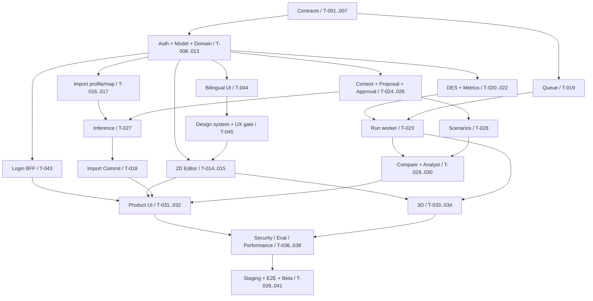

# Implementation Plan / Dependency Graph / Definition of Done

SOURCE：原報告 pp.47–50。四位工程師／16週為baseline，17–20週為risk buffer；3人可能接近18–20週。以下task拆分、dependencies、DoD是候選工程計畫，不是原報告已估算的agent工時。

## 1. 開發順序

先固定 Model IR schema → Go domain types → validators → versioning → DES → API → React Flow → AI proposal → results → 3D。基礎schema/DB/auth/CI與frontend shell可平行；不可先完成華麗UI再補三套不同model。

`planning/tasks.json` 是機器可讀任務來源，共42個task，全部not_started。它包含 depends_on、requirement_ids、decision_gates、scope、planned_outputs、acceptance_tests、verification_commands、definition_of_done、completion_evidence。任務編號不是排程順序；T-018例如依賴較後编号的proposal/inference接口，必须按DAG选择。

## 2. 里程碑與依賴主幹

T-035 audit/observability 基線應從第一個write/job即接入，Week12–14做完整硬化；不是到第12週才補tenant safety。T-042是test-only generic boundary guard，不是P0增加第二個客戶domain。T-043（BFF 登入，ADR-018）與 T-044（en 預設＋zh-Hant，REQ-022）為 2026-10-18 依 owner 決定（H-004、H-005）新增；T-044 在 T-015 之前完成，之後的 UI 任務一律經 catalog。

## 3. 工作分配與週程

| Workstream | 主要task | 原報告時程對齊 |
|---|---|---|
| Platform | bootstrap、DB/RLS/auth/projects、versioning、queue、run API、audit/deploy | Week1–8；Week12–16 hardening |
| Simulation | IR/semantic/hash、DomainPack、DES、metrics、differential/benchmark | Week1–8；Week13–15 validation |
| Frontend | app、2D、import/review/results UI、3D/playback | Week3–12 |
| AI / Full-stack | import/profile/map、provider/context、proposal/inference、analyst/evals | Week4–12；Week13–15 eval |

security/RLS/contract tests從每個slice開始；來源的Week12–14是整體硬化窗口。所有dependency都在tasks.json明列，不用自然語言週程取代。

## 4. 開始一個task的條件

dependency完成且有證據；必要decision已由人類確認，或本task明確只做spike/contract review；source/spec已讀；expected errors和negative cases可列出；本輪scope可驗收。不得以「agent可一次做完」為理由跨越未定義的contract。

first pass只做T-001/T-002。接著T-003/T-004，驗contracts/validator後再持久化/model lifecycle。前後端可以用已批准的contract parallel work；mock必須顯式標示且不能用來通過production gates。

## 5. Task completion / PR DoD

每task完成時：提交真實功能與tests，對照requirement/test IDs；運行verification_commands並附exit code/結果；更新schema/OpenAPI/DB/SDK對齊；記錄concurrency/security/rollback影響；error path可重現；沒有secret/raw customerdata；沒有擅自P1。completion_evidence記錄commit、test artifact、決策review者；不修改source fixture讓錯誤看似通過。

not_started→in_progress→blocked/review→done 是規劃狀態。blocked必須寫缺的dependency/decision/test環境。驗收需真實跑過，未執行標NOT RUN；不能把Makefile內「尚未實作」命令改成echo success。

## 6. Milestone DoD

Alpha：manual model→immutable version→simulation→results，在固定fixture重現。AI Alpha：intent→ready proposal→human approve→exactly one version；reject/stale/double-approve測試都過。Product Alpha：CSV→mapping→dataset commit→inference proposal→approval→scenario→run→compare→analysis，含2D/3D與audit。Private Beta：真實外部團隊資料、反覆what-if決策與decision usefulness證據；retention/residency/provider政策已定。

Beta release要同時滿足docs/TEST_PLAN的gates、backup/restore、runtime privilege、production人工批准。原報告的工程threshold未達時只能記錄並請人類調整，不自行宣告達標。

## 7. 交付風險與處理

IR/Schema晚變更會傳到AI/UI/engine/DB：先批准D-001/D-014與contract tests。DES語義不一致：先批准D-005/D-006及golden，固定numeric profile。AI quality不夠：流程先用fake完成，但live能力維持blocked，不能以高confidence繞審核。dirty draft/Scenario/import commit ambiguity：採D-003/D-004/D-009或記錄替代方案，四種contracts同時更新。

3D工期過大時降低polish，不刪P0viewer，也不擴成authoring。性能不足先profile/演算法，符合原報告trigger才benchmarkRust。外部provider/retention遲未定時可做synthetic staging，不能偷偷把真實客戶資料送到任意服務。

## 8. 逐task摘要

- **T-001 — 來源盤點、決策 review 與實作邊界**：Platform + Product；Week 1；依賴 無。具體scope/commands/DoD見tasks.json。
- **T-002 — Repository、toolchain、CI skeleton**：Platform；Week 1–2；依賴 T-001。具體scope/commands/DoD見tasks.json。
- **T-003 — 凍結候選契約與 Go/TypeScript domain types**：Platform + Simulation；Week 1–2；依賴 T-001, T-002。具體scope/commands/DoD見tasks.json。
- **T-004 — IR / patch semantic validator**：Simulation；Week 2–3；依賴 T-003。具體scope/commands/DoD見tasks.json。
- **T-005 — JCS/hash、frozen dataset manifest**：Platform + Simulation；Week 2–3；依賴 T-003。具體scope/commands/DoD見tasks.json。
- **T-006 — Core migration 與 repository foundation**：Platform；Week 1–3；依賴 T-003。具體scope/commands/DoD見tasks.json。
- **T-007 — RLS、runtime roles、pool isolation**：Platform；Week 2–3；依賴 T-006。具體scope/commands/DoD見tasks.json。
- **T-008 — OIDC/JWT authentication**：Platform；Week 2–3；依賴 T-002, T-007。具體scope/commands/DoD見tasks.json。
- **T-009 — Project service 與 server RBAC**：Platform；Week 3；依賴 T-008, T-007, T-003。具體scope/commands/DoD見tasks.json。
- **T-010 — 受控 onboarding / membership 管理**：Platform；Week 3–4；依賴 T-008, T-009。具體scope/commands/DoD見tasks.json。
- **T-011 — SoftwareDeliveryDomainPack / full template**：Simulation；Week 3–4；依賴 T-004。具體scope/commands/DoD見tasks.json。
- **T-012 — Model / Draft / Version service**：Platform；Week 3–4；依賴 T-004, T-005, T-009, T-011。具體scope/commands/DoD見tasks.json。
- **T-013 — Model HTTP contract / client integration**：Platform；Week 4；依賴 T-012, T-003。具體scope/commands/DoD見tasks.json。
- **T-014 — Frontend app / server-state boundary**：Frontend；Week 3–4；依賴 T-002, T-003。具體scope/commands/DoD見tasks.json。
- **T-015 — React Flow 2D authoring**：Frontend；Week 3–5；依賴 T-014, T-013, T-011。具體scope/commands/DoD見tasks.json。
- **T-016 — CSV/JSON upload、profile、private storage**：AI / Full-stack；Week 4–5；依賴 T-009, T-006, T-003。具體scope/commands/DoD見tasks.json。
- **T-017 — Canonical mapping / full validation pipeline**：AI / Full-stack；Week 5–6；依賴 T-016, T-004。具體scope/commands/DoD見tasks.json。
- **T-018 — Dataset commit → inference proposal**：AI / Full-stack；Week 7–8；依賴 T-017, T-005, T-012, T-019, T-025, T-027。具體scope/commands/DoD見tasks.json。
- **T-019 — PostgreSQL job queue / leases**：Platform；Week 5–6；依賴 T-007, T-009, T-003。具體scope/commands/DoD見tasks.json。
- **T-020 — DES compiler、clock、heap、RNG**：Simulation；Week 5–6；依賴 T-004, T-005, T-011。具體scope/commands/DoD見tasks.json。
- **T-021 — DES resource/queue/service/routing kernel**：Simulation；Week 6–7；依賴 T-020。具體scope/commands/DoD見tasks.json。
- **T-022 — Metric aggregation / result digest / trace**：Simulation；Week 6–8；依賴 T-021。具體scope/commands/DoD見tasks.json。
- **T-023 — Run API / worker / cancellation integration**：Platform + Simulation；Week 7–8；依賴 T-019, T-021, T-022, T-013。具體scope/commands/DoD見tasks.json。
- **T-024 — Sanitized AI context / provider adapter**：AI / Full-stack；Week 6–8；依賴 T-008, T-003, T-012。具體scope/commands/DoD見tasks.json。
- **T-025 — Async proposal generation / validation**：AI / Full-stack；Week 7–9；依賴 T-024, T-019, T-004, T-005, T-012。具體scope/commands/DoD見tasks.json。
- **T-026 — Human approve/reject / canonical effect**：Platform + AI；Week 8–10；依賴 T-025, T-012。具體scope/commands/DoD見tasks.json。
- **T-027 — AI mapping suggestion / event inference**：AI / Full-stack；Week 7–9；依賴 T-024, T-017, T-025。具體scope/commands/DoD見tasks.json。
- **T-028 — Scenario persistence / parameter-only approval**：Platform + AI；Week 9–11；依賴 T-026, T-005, T-013。具體scope/commands/DoD見tasks.json。
- **T-029 — Results / baseline comparison API**：Simulation + Platform；Week 9–11；依賴 T-022, T-023, T-028。具體scope/commands/DoD見tasks.json。
- **T-030 — Grounded AI simulation analyst**：AI / Full-stack；Week 9–12；依賴 T-029, T-024, T-019。具體scope/commands/DoD見tasks.json。
- **T-031 — Import / proposal / review UI**：Frontend；Week 8–11；依賴 T-015, T-018, T-026, T-027, T-028。具體scope/commands/DoD見tasks.json。
- **T-032 — Simulation / compare / analyst dashboard**：Frontend；Week 9–12；依賴 T-031, T-023, T-029, T-030。具體scope/commands/DoD見tasks.json。
- **T-033 — PlayCanvas read-only 3D adapter**：Frontend；Week 10–12；依賴 T-015, T-023。具體scope/commands/DoD見tasks.json。
- **T-034 — 3D sampled playback / timeline**：Frontend；Week 11–12；依賴 T-033, T-032。具體scope/commands/DoD見tasks.json。
- **T-035 — Audit / OpenTelemetry / structured logs**：Platform；Baseline in each write task; integration Week 6–8; harden Week 12–14；依賴 T-009, T-019。具體scope/commands/DoD見tasks.json。
- **T-036 — Security hardening / adversarial integration**：Platform + all；Week 12–14；依賴 T-010, T-018, T-026, T-028, T-030, T-034, T-035。具體scope/commands/DoD見tasks.json。
- **T-037 — Simulation differential / performance acceptance**：Simulation + Frontend；Week 13–15；依賴 T-022, T-023, T-034。具體scope/commands/DoD見tasks.json。
- **T-038 — AI corpus / live-provider release eval**：AI / Full-stack；Week 13–15；依賴 T-025, T-026, T-027, T-030。具體scope/commands/DoD見tasks.json。
- **T-039 — Containers / staging reference deployment**：Platform；Week 12–15；依賴 T-013, T-023, T-024, T-035, T-014。具體scope/commands/DoD見tasks.json。
- **T-040 — Product Alpha E2E / pilot hardening**：All + Product；Week 15–16；依賴 T-032, T-034, T-036, T-037, T-038, T-039。具體scope/commands/DoD見tasks.json。
- **T-041 — Backup/restore、data policy、Private Beta gate**：Platform + Product；Week 15–16; buffer 17–20；依賴 T-040。具體scope/commands/DoD見tasks.json。
- **T-042 — Generic kernel / adapter dependency guard**：Simulation；Week 6–8；依賴 T-011, T-020。具體scope/commands/DoD見tasks.json。
- **T-043 — Browser login session (BFF, ADR-018)**：Frontend / Security；Week 3–5；依賴 T-008, T-014。具體scope/commands/DoD見tasks.json。
- **T-044 — Bilingual UI foundation (en default, zh-Hant)**：Frontend；Week 3–4；依賴 T-014, T-011。具體scope/commands/DoD見tasks.json。
- **T-045 — Design system, UI library evaluation and UX gate**：Frontend / Design；Week 4–5；依賴 T-014, T-044；T-015 依賴它（H-007）。具體scope/commands/DoD見tasks.json。
