# 電子組裝／測試線 Domain 規格（提案）

狀態：**PROPOSED**（T-046 phase 1，2026-10-19，agent 提出；owner 尚未批准）。依據：H-016、[ADR-025](../adr/ADR-025-p0-domain-electronics-line.md)、[PRD](../PRD.md) REQ-003／004／013／015／024／025、[TEST_PLAN](../TEST_PLAN.md) TEST-034–036。引擎的新 primitive 見 [ADR-026](../adr/ADR-026-line-flow-primitives.md)（D-047–D-057）；本文件自己的 decision 為 D-058–D-060（§10）。全部 decision 的狀態以 [DECISIONS_AND_TBD](../DECISIONS_AND_TBD.md) 與 `planning/decisions.json` 為準。

**數字與來源。** 本文件所有數值都是 **synthetic 示意值**：只為了讓 template 能執行並展示行為，不是任何工廠的實測值，也不是「典型值」。關於工廠資料與工程師期待的說法來自 agent 的研究稿（未提交、未經驗證），只當輸入，不當事實。

## 1. 範圍

- **流動單位**：一片板子（entity type `board`）；機櫃變體為一個機櫃（`rack`，§4.3）。P0 不做拼板／分板（合併與拆分，ADR-026 延後項目），一個 entity 就是一片板子。
- **站別**：SMT → AOI → ICT → FCT → 燒機 → 包裝出貨，含測試失敗 → 除錯 → 重測，與無法修復時的報廢。
- **代表問題**（PRD §2）：目前 ICT 測試機 2 台、FCT 3 台、FCT 前緩衝 10 片；增加 1 台 ICT 或加大緩衝時，UPH、瓶頸站、WIP、utilization、阻塞時間與重測比例如何改變。
- **P0 不做**：換線（D-055）、多產品組合、優先權與派工規則、搬運（以 delay node 近似）、作業員技能、服務中斷（preemption）、跨步驟持有 resource（§4.3）。

## 2. 站別與典型結構

以下是 P0 的建模方式，不是對所有工廠的描述；實際產線的結構差異很大，T-027 的推論與使用者確認決定實際模型。

| 站 | 做什麼（概述） | IR 表示（提案） | 用到的 primitive |
|---|---|---|---|
| SMT | 錫膏印刷、零件置放、迴焊等組成的一條線 | 一個 process，resource `smt_line`（整條線視為一個 server，線內各機台的平衡不建模） | 故障、班表 |
| AOI | 自動光學檢查 | process（`aoi`）＋ decision（pass／fail）；fail 經 failure node 到人工修補，再進 ICT | 有限緩衝、故障、班表 |
| ICT | 電路測試 | 首測 process 與重測 process 共用 `ict_tester`；fail → failure node → 除錯 → rework node → 重測 | 有限緩衝、故障、班表 |
| FCT | 功能測試 | 同 ICT 的結構，resource `fct_tester` | 同上 |
| 燒機 | 在 chamber 內長時間通電 | 批次 process（`burn_in_chamber`，min／max／max_wait） | 批次、故障；通常不受班表限制 |
| 除錯／修補 | 人工判讀與修理 | process，resource `debug_operator`；decision 決定修好或報廢 | 班表 |
| 包裝出貨 | 包裝、出貨 | process（`pack_station`）→ completed sink | 有限緩衝、班表 |
| 緩衝 | 站間的 WIP 架或輸送帶 | 顯式 queue node，主線為有限 `capacity`；除錯與重測前為無限（D-050） | 有限緩衝 |

**首測與重測分開。** IR 的 routing 沒有記憶，同一個 process 無法分辨首測與重測，所以 template 把重測建成另一個 process、與首測共用測試機（兩者依 resource-wise FIFO 排隊）。這讓首次良率可以直接由首測 decision 讀出（§5），也允許重測時間與良率和首測不同。

**除錯分站。** 除錯後必須回到「原來的」測試站，而機率路由無法依來源分流，所以 ICT 與 FCT 各有自己的除錯 process，共用 `debug_operator`。

## 3. Catalog

### 3.1 Node kinds（pack catalog → generic type）

| Kind | Generic type | 說明 |
|---|---|---|
| `board_release` | source | 投入；固定分布或 release schedule（D-053） |
| `line_buffer` | queue | 站前緩衝；可有 `capacity`（D-049） |
| `smt_station`、`aoi_station`、`ict_station`、`fct_station`、`pack_station` | process | 主線站別 |
| `retest_station` | process | 重測，與首測共用測試機 |
| `debug_station` | process | 除錯／修補，需要 `debug_operator` |
| `burn_in_station` | process（batch） | 批次燒機（D-054） |
| `test_result` | decision | 測試結果；恰有一條 flow 到 failure node（fail），其餘為 pass |
| `debug_result` | decision | 修好或報廢 |
| `defect_observation` | failure | 記錄測試不良（generic failure，不是機台故障） |
| `rework_observation` | rework | 記錄修理後重入 |
| `transport` | delay | 搬運或等待，不占 resource |
| `shipped` | sink（completed） | 出貨 |
| `scrap` | sink（abandoned） | 報廢；不計入產出 |

### 3.2 Resource roles

| Role | Type | 說明 |
|---|---|---|
| `smt_line` | machine | 一條 SMT 線（視為一個 server） |
| `aoi` | machine | AOI 機台 |
| `ict_tester` | machine | ICT 測試機 |
| `fct_tester` | machine | FCT 測試機或測試治具 |
| `burn_in_chamber` | machine | 燒機室；以批計（一批占一個 unit） |
| `debug_operator` | human | 除錯／修補人員 |
| `pack_station` | human | 包裝站 |
| `test_slot` | machine | 機櫃變體的測試槽位（§4.3） |
| `assembler` | human | 機櫃變體的組裝人員 |
| `debug_engineer` | human | 機櫃變體的除錯工程師 |
| `generic` | generic | 其他受限能力，沒有 domain 語義 |

Kernel 不依 role 字串決定行為（TWIN_IR_SPEC §2）；role 只給 pack 的 validation、指標與 UI 使用。

### 3.3 `domain_attributes` 慣例（提案）

- 主線站與重測站的 process：`station`（站別 ID，如 `fct`）、`pass`（`first` 或 `retest`）。
- `test_result` decision：`result_of`（被測的 process ID）。
- 這些是 pack 的慣例，是不可信資料（UNTRUSTED_DATA）；generic kernel 不讀。

### 3.4 Pack 的 validation 規則（提案，T-051）

1. 每個主線站 process 恰有一個 role 與站別相符的 primary resource（另可加作業員）。
2. 每個 `test_result` decision 恰有一條 flow 到 failure node；沒有時該站的 FPY 為 unavailable，並回 warning。
3. 首測與重測站共用同一個 primary resource。
4. 示範 template 的參數都在 `metadata` 標 `synthetic: true`（UI 顯示 synthetic 標記）。
5. Generic validator 的規則（含 `BLOCKING_CYCLE`）不在 pack 中重複。

## 4. Full template（提案，synthetic）

### 4.1 拓樸

```mermaid
flowchart LR
  REL[board_release] --> QS[q_smt] --> SMT[smt]
  SMT --> QA[q_aoi 20] --> AOI[aoi] --> AR{aoi_result}
  AR -- 0.97 --> QI[q_ict 10]
  AR -- 0.03 --> AD[aoi_defect] --> QT[q_touchup] --> AT[aoi_touchup] --> AW[aoi_rework] --> QI
  QI --> ICT[ict] --> IR{ict_result}
  IR -- 0.95 --> QF[q_fct 10]
  IR -- 0.05 --> IF[ict_fail] --> QID[q_ict_debug] --> ID[ict_debug] --> IDR{ict_debug_result}
  IDR -- 0.97 --> IW[ict_rework] --> QIR[q_ict_retest] --> IRT[ict_retest] --> IRR{ict_retest_result}
  IDR -- 0.03 --> SCRAP[(scrap)]
  IRR -- 0.90 --> QF
  IRR -- 0.10 --> IF
  QF --> FCT[fct] --> FR{fct_result}
  FR -- 0.93 --> QB[q_burnin 80]
  FR -- 0.07 --> FF[fct_fail] --> QFD[q_fct_debug] --> FD[fct_debug] --> FDR{fct_debug_result}
  FDR -- 0.95 --> FW[fct_rework] --> QFR[q_fct_retest] --> FRT[fct_retest] --> FRR{fct_retest_result}
  FDR -- 0.05 --> SCRAP
  FRR -- 0.90 --> QB
  FRR -- 0.10 --> FF
  QB --> BI[burn_in batch] --> BR{burnin_result}
  BR -- 0.995 --> QP[q_pack 30] --> PACK[pack_ship] --> SHIP[(shipped)]
  BR -- 0.005 --> BF[burnin_fail] --> QFD
```

Queue 名稱後的數字是 synthetic 的 `capacity`；沒有數字的 queue 為無限（`q_smt` 也是無限，所以 source 的 release backlog 不會出現在 template 中）。

**死結檢查（D-050）。** Holder 的共用分量：{ict, ict_retest}（`ict_tester`）、{fct, fct_retest}（`fct_tester`）、{aoi_touchup, ict_debug, fct_debug}（`debug_operator`），其餘各自一個。阻塞邊：smt→aoi、aoi→ICT、除錯→ICT（經 `aoi_rework` 進 `q_ict`）、ICT→FCT、FCT→燒機、燒機→包裝。除錯與重測前的 buffer 無限，所以沒有回到上游的邊，圖無 cycle，通過。若把 `q_ict_retest` 或 `q_fct_debug` 改為有限，就會出現 cycle 並被拒絕。

### 4.2 參數（全部 synthetic）

時間單位為 minute。三角分布寫作 tri(min, mode, max)。

| Resource | Type | Capacity | 班表 | 故障 TTF | 故障 TTR |
|---|---|---|---|---|---|
| `smt_line` | machine | 1 | `two_shift_weekdays` | exponential(mean 600) | tri(10, 20, 90) |
| `aoi` | machine | 1 | `two_shift_weekdays` | exponential(mean 1200) | tri(5, 10, 30) |
| `ict_tester` | machine | 2 | `two_shift_weekdays` | exponential(mean 900) | tri(10, 20, 60) |
| `fct_tester` | machine | 3 | `two_shift_weekdays` | exponential(mean 900) | tri(10, 30, 90) |
| `burn_in_chamber` | machine | 4 | 無（24/7） | exponential(mean 10080) | tri(60, 120, 480) |
| `debug_operator` | human | 4 | `two_shift_weekdays` | — | — |
| `pack_station` | human | 1 | `two_shift_weekdays` | — | — |

| Process | 需要 | Service time |
|---|---|---|
| `smt` | smt_line ×1 | tri(0.9, 1.0, 1.4) |
| `aoi` | aoi ×1 | tri(0.8, 0.9, 1.1) |
| `aoi_touchup` | debug_operator ×1 | tri(3, 5, 10) |
| `ict`、`ict_retest` | ict_tester ×1 | tri(1.8, 2.0, 2.6) |
| `ict_debug` | debug_operator ×1 | tri(5, 10, 30) |
| `fct`、`fct_retest` | fct_tester ×1 | tri(2.8, 3.2, 4.0) |
| `fct_debug` | debug_operator ×1 | tri(10, 20, 60) |
| `burn_in` | burn_in_chamber ×1（每批） | constant 240（每批）；batch min 20、max 40、max_wait 120 |
| `pack_ship` | pack_station ×1 | tri(0.8, 1.0, 1.5) |

- **班表** `two_shift_weekdays`：period 10080（一週），shifts 為週一至週五的 [360, 1320)＋d·1440（06:00–22:00，兩個 8 小時班相連、不含休息），t=0 為週一 00:00（model 本地時間，D-052）。
- **投入**：`board_release` 的 release schedule（D-053），deterministic、period 10080，上述上班時段 rate 0.75／minute（45／小時），其餘 0。
- **Routing 機率**：見 §4.1 的圖。
- **粗估（未經引擎驗證）**：依平均值，FCT 的負載最接近容量，預期是瓶頸，ICT 不是；這正好讓「加 ICT」與「加大 FCT 前緩衝」兩個 scenario 有不同答案。T-051 要以引擎實測確認並在必要時調整參數（CB-24 曾發現原 template 的 reviewer 過載），調整同樣標 synthetic。
- 名稱提供 en 與 zh-Hant 兩語（ARCHITECTURE §7 的 TemplateProvider），ID 不變。

### 4.3 機櫃整合測試變體（AI 伺服器）

| 站 | IR 表示（提案） | 參數（synthetic） |
|---|---|---|
| 組裝 | process，`assembler` ×1（capacity 4） | tri(120, 180, 300) |
| 系統測試 | process，`test_slot` ×1（capacity 12） | tri(240, 360, 720) |
| 測試結果 | decision：pass 0.85／fail 0.15 → 除錯 | — |
| 除錯 | process，`debug_engineer` ×1（capacity 3）；採下述近似時另加 `test_slot` ×1 | tri(60, 180, 600) |
| 重測 | process，與系統測試共用 `test_slot` | 同系統測試 |
| 包裝出貨 | process → shipped | tri(60, 90, 120) |

限制：實務上機櫃常在測試槽內除錯（槽位在除錯期間仍被占用）；P0 的 resource 在每個 process 結束時釋放，無法跨步驟持有，所以除錯期間槽位會被釋放。這會高估槽位的可用時間；P0 的近似是把除錯建成同時需要 `test_slot` 與 `debug_engineer` 的 process（重新取得槽位，等待時間可能偏長），並在結果中標示此近似。跨步驟持有 resource 屬 P1。長時間的測試也讓 finish-first（D-051、D-052）的低估更明顯。

## 5. Domain 指標（REQ-015）

**符號。** 每個 replication r 的量測視窗 [W, H]，T＝H−W（tick）。Resource ρ：capacity C；班表容量 S(t)（沒有班表時 S≡C）；停機 unit 數 D(t)（沒有故障時 0）；使用中 unit 數 U(t)（現行 `in_use`）；其中被 blocked entity 持有的 K(t)（沒有有限 buffer 時 0），處理中 P(t)＝U(t)−K(t)；可用的排班容量 A(t)＝min(S(t), C−D(t))。積分都在 [W, H]。除非另註，指標是每個 replication 一個值，跨 replications 以現行 MetricSummary 彙整（population＝replication，Student-t CI，SIMULATION_SPEC §5）。

**站別的 primary resource**：§3.4 規則 1 的 resource；指標以它代表該站。

| 指標 | 公式 | 需要的語義資料 | Unavailable（暫定 reason） |
|---|---|---|---|
| UPH（日曆小時） | UPHᵣ＝Nᵣ ／ (T／3,600,000)，Nᵣ＝視窗內進入 completed sink 的件數（現行 throughput） | completed sink（`shipped`） | 沒有 completed sink：`NO_COMPLETED_SINK` |
| UPH（排班小時） | Nᵣ ／ (L／3,600,000)，L＝線班表在 [W, H] 內的上班時間（不乘 capacity） | 線班表＝主線站中有 calendar 者共用的那一個 calendar；沒有 calendar 的站（例如 24/7 的燒機）不影響 | 沒有任何主線站有 calendar，或用了兩個以上不同的 calendar：`NO_COMMON_LINE_CALENDAR`；L＝0：`NO_SCHEDULED_TIME_IN_WINDOW` |
| 首次良率 FPY（站） | 模型輸入：首測 `test_result` 的 pass flow 機率和（＝1−fail flow 機率）；觀測值見 §7 | `pass: first` 的站與其 `test_result`（§3.3） | 找不到首測 decision 或 fail flow：`TEST_RESULT_NOT_IDENTIFIED` |
| Rolled throughput yield | 主線各測試站（AOI、ICT、FCT、燒機）FPY 的乘積（模型輸入） | 同上，每個測試站都可辨識 | 任一站 unavailable：同上 |
| 線 WIP | ∫Nsys(t)dt ／ T，Nsys＝已建立、尚未離開的 entity 數（含 release backlog、等待、服務中、被擋、delay） | IR `metrics[]` 宣告 `system_wip`（D-058） | 未宣告：`WIP_NOT_DECLARED` |
| 緩衝 WIP | 現行 `queue_length_mean` | — | 照現行 |
| 阻塞比例（站） | ∫K(t)dt ／ (C·T)（primary resource） | 模型至少有一個有限 buffer（D-049） | 沒有有限 buffer：`NO_FINITE_BUFFERS`（模型假設無限緩衝，阻塞未建模） |
| 平均阻塞時間（站） | 完整阻塞（開始 ≥ W、結束 ≤ H）的平均時間（minute） | 同上 | 同上；沒有完整阻塞：`NO_COMPLETED_BLOCK_IN_WINDOW` |
| 停機比例（站） | ∫D(t)dt ／ (C·T) | resource 有 `breakdowns`（D-051） | `NO_BREAKDOWN_MODEL` |
| Availability（站） | ∫A(t)dt ／ ∫S(t)dt（時間可用率） | 同上 | `NO_BREAKDOWN_MODEL`；∫S＝0：`NO_SCHEDULED_TIME_IN_WINDOW` |
| 缺料（starved）比例（站） | ∫max(0, A(t)−U(t))dt ／ (C·T) | primary resource 只被該站（首測與重測）使用，且這些 process 只需要它一個 resource | 否則：`STARVATION_UNDEFINED_SHARED_RESOURCE`（改以「閒置比例」顯示同一公式） |
| 下班比例（站） | 1 −（處理＋阻塞＋停機＋閒置），處理＝∫P／(C·T) | — | — |
| Scheduled utilization（站） | ∫min(U, S)dt ／ ∫S dt（D-052） | resource 有 calendar | 沒有 calendar 時與 `utilization_mean` 相同，不另列；∫S＝0：`NO_SCHEDULED_TIME_IN_WINDOW` |
| Overtime（站） | ∫max(U−S, 0)dt ／ 60,000（minute） | resource 有 calendar | 同上 |
| Line balance | LBᵣ＝mean_s(w_s) ／ max_s(w_s)，w_s＝∫min(P, S)dt ／ ∫S dt（主線各站的 primary resource，每個 resource 只算一次） | 至少 2 個主線站可辨識 | 少於 2 站：`TOO_FEW_STATIONS`；max w＝0：`NO_PROCESSING_IN_WINDOW`；站的 role 缺：`STATION_ROLE_MISSING` |

說明：

- **五種狀態的比例相加為 1**：處理 P、阻塞 K、停機 D、閒置 max(0, A−U)、下班（其餘）。Finish-first 讓 U 可能暫時超過 A（overtime 或尚未停機的故障），此時閒置為 0、下班比例相應變小；因為 U＋D ≤ C 恆成立，下班比例不會小於 0。
- **閒置只在專用 resource 時才叫缺料**：專用且單一 resource 的站，若有 unit 閒置而 buffer 有件，dispatch 會在同一 tick 授予，所以閒置必然是 buffer 空；共用 resource 或多 resource bundle 的閒置可能是在等別的 resource（D-038 (m)），不能稱為缺料。
- **候選瓶頸**：w_s 最大的站（同值取 node ID 較小者），在 UI 顯示為「工作比例最高的站」；這是常見的判讀方式，不是證明。
- **不稱 OEE**：P0 不計算 OEE。Utilization 不是 OEE；availability 只是時間可用率，沒有 performance（理想 cycle time）與 quality 因子。UI 與 AI analyst 都不得把任何指標標為 OEE。
- **FPY 是輸入**：機率路由下，模擬出來的首測通過比例只是輸入機率加上抽樣誤差，不是預測；P0 把它當模型輸入顯示，並在 §7 與觀測值比對。實際的通過次數統計延後到 IR `metrics[]` 與 Result 的對應（T-029，CB-22）。
- **沒有的功能不填 0**：模型沒有故障、有限緩衝或班表時，對應指標回 unavailable 並說明模型的假設，而不是顯示 100% availability 或 0 阻塞（REQ-015：不捏造）。
- Lead time、queue wait、utilization、failure／rework count 沿用現行定義；lead time 從投入（arrival）起算，含 release backlog。報廢率需要 abandoned 件數，現行 Result 沒有，延後。

## 6. Station event log 的 canonical fields（import mapping）

兩種紀錄。對應的 canonical-event 欄位中，`end_timestamp` 與 `shift` 是 D-059 提議新增的 optional 欄位（尚未改 schema）。

**作業紀錄**（一片板子在一站的一次作業或測試）：

| 邏輯欄位 | 必填 | canonical-event | 說明 |
|---|---|---|---|
| serial | 是 | `case_id` | 板子或機櫃的序號 |
| station | 是 | `stage` | 站別；mapping 時由使用者對應到 IR 的站 |
| record type | 是 | `event_type` | pack 詞彙：`operation`；CSV 沒有此欄時需要常數 transform（CB-28，T-017） |
| equipment | 建議 | `resource_id` | 機台、測試機或 chamber 的 ID；用於推論 capacity 與停機對應 |
| start | 是 | `timestamp` | RFC 3339 含 offset；沒有時區的時間一律拒絕（TWIN_IR_SPEC §7） |
| end | 是（推論需要） | `end_timestamp`（新增） | ≥ start |
| result | 測試站必填 | `outcome` | `pass`／`fail`；其他值為 data-quality issue |
| shift | 選填 | `shift`（新增） | 班別標籤，只用於 §7 的分組 |
| duration | 選填 | `duration_ms` | 與 end−start 不一致時為 data-quality issue（TWIN_IR_SPEC §7） |
| product／family | 選填 | `metadata` | P0 只有一個產品族（D-055） |
| operator ID | **不匯入** | — | 個人資料；mapping 時保持未對應，不進 dataset、prompt 或 telemetry |

**停機紀錄**（一台設備的一段停機）：`case_id`＝設備 ID（canonical-event 要求 case_id），`event_type`＝`downtime`，`resource_id`＝設備 ID，`stage`＝站別，`timestamp`＝停機開始，`end_timestamp`＝恢復，`outcome`＝原因碼（選填）。計畫停機（休息、保養）若有原因碼可辨識，推論時排除於故障之外。

**Data-quality 檢查（提案）**：end < start；同一 serial 的作業時間重疊；同一設備的作業數超過推論的 capacity；serial 的站別順序與拓樸不符；停機與作業在同一設備上重疊（停機中仍有作業）；觀測期間內的資料缺口。研究稿指出微小停機常未被記錄、彙總的 OEE 不足以建模故障（未驗證）；因此 P0 只用逐筆停機紀錄估計故障參數，缺少時 `breakdowns` 由使用者輸入或回 needs_input，不從 OEE 反推。

**可推導的量（T-027 的範圍，此處只作參考）**：各站 service time 樣本＝end−start（empirical dataset）；首測與重測以 serial＋station 依 start 排序區分；routing 機率與 FPY 由 result 計數；TTR＝恢復−停機開始；TTF＝上次恢復到下次停機開始的日曆時間（與 D-051 的時鐘一致）；release rate 由第一站的 start 依時段計數；設備並行數由同時進行的作業推估 capacity。推論結果一律經 proposal 與人類批准（D-009），不直接改 Twin。

**時間對應。** Model 時間沒有時區。比對與推論時，使用者指定一個 anchor（例如 model t=0 ＝ 某個含 offset 的 RFC 3339 時刻，且為班表 period 的起點）；跨 DST 變換的視窗在 P0 回 data-quality issue。

## 7. 模擬與觀測的比對（REQ-025）

只在 baseline run 有連結的觀測 dataset 時進行；以下是 D-060 的提案。

| 量 | 觀測 | 模擬 | 類別 |
|---|---|---|---|
| 線產出／期（日、週，或班） | 視窗內在最後一站（包裝出貨）完成作業的 serial 數 ÷ 期數 | 每個 replication 的 throughput ÷ 期數 | **輸出比對** |
| 站別 queue wait（mean） | 本站 start − 該 serial 上一站 end（含搬運與上游阻塞，與模擬的定義不完全相同，標「近似」） | 現行 queue wait ＋ 上游阻塞（有有限 buffer 時） | 輸出比對（近似） |
| Lead time（mean） | 投入（第一站 start，或 log 中的投入事件）到出貨的時間 | lead time（從 arrival 起算，含 SMT 前等待；起點不同時標「近似」） | 輸出比對（近似） |
| 站別 cycle time（mean／p50／p95） | end − start | 模型的 service time 分布 | **輸入一致性** |
| FPY（站） | 首次作業 pass 的 serial ÷ 有作業的 serial | 模型輸入（§5） | 輸入一致性 |
| Availability、MTBF、MTTR（站） | 停機紀錄（排班時間內） | 模型的 TTF／TTR 與模擬的 availability | 輸入一致性 |

- **「輸入一致性」不是驗證**：比的是模型參數是否與資料相符；只有「輸出比對」能說明模型行為與觀測接近。UI 分兩區顯示。
- **誤差的呈現**：觀測值 o；各 replication 的模擬值 xᵣ；顯示模擬平均 x̄、模擬範圍（R ≥ 20 時為 Type 7 的 2.5% 與 97.5% 分位，否則為 min–max，並標明用哪一種）、絕對誤差 x̄−o、相對誤差 (x̄−o)／o（o＝0 時為 null，reason `OBSERVED_ZERO`），以及 o 是否落在模擬範圍內。逐期的序列比較需要 Result 有每期的計數（目前沒有），延後。
- **In-sample 與 hold-out**：若模型的參數（empirical dataset 或推論來源）取自涵蓋該觀測視窗的資料，標為 **in-sample**，並說明這不是驗證；建議以前幾週推論、最後一週比對（T-052 的 synthetic 資料應提供這種切分）。
- **Unavailable（暫定 reason）**：沒有連結的觀測 dataset：`NO_OBSERVED_DATA`；觀測視窗少於一期：`OBSERVED_WINDOW_TOO_SHORT`；需要的欄位未 mapping（例如沒有 result）：`OBSERVED_FIELD_MISSING`；兩邊視窗不是整數期或無法以 anchor 對齊：`OBSERVED_WINDOW_NOT_ALIGNED`；模擬端指標 unavailable：`SIMULATED_METRIC_UNAVAILABLE`。
- **不宣稱已校準**：不給「通過／不通過」的判定，不自動調整模型參數；AI analyst 只能引用這些數字並以 proposal 建議修改（REQ-016、D-016）。示範資料一律標 synthetic。

## 8. 示範流程（研究稿的提案，作為輸入）

1. 上傳一週 synthetic 的 station log（T-052 以固定 seed 從已知的 ground-truth 模型產生）。
2. Mapping 與 validation → 凍結 dataset → AI 提出站別、cycle time 分布、良率與重測迴圈、緩衝的 proposal → 工程師審核批准（D-009）。
3. Baseline：UPH、候選瓶頸、WIP、utilization、阻塞與缺料比例，以及模擬與觀測的每週產出比對（§7）。
4. Scenario：「ICT +1 台」與「FCT 前緩衝加大」，比較並由 analyst 解釋。第二個 scenario 需要 D-057（buffer capacity 可在 scenario 中修改）；若 D-057 不批准，它必須發布新版本，與 baseline 不可比較（SIMULATION_SPEC §7）。

## 9. 延後與限制

換線與產品組合（D-055）；lognormal／Weibull（D-056）；服務中斷（故障、交班）；每班不同人數；假日、時區與 DST；明確投入表；capacity 0 的 buffer；拼板／分板；跨步驟持有 resource（機櫃在槽內除錯）；優先權與派工規則；作業員技能；AGV 與搬運系統（P0 以 delay）；實際的 FPY 與重測次數統計、報廢率、逐期序列比較（需要 IR `metrics[]` 與 Result 的對應，T-029）；設備在 SMT 線內的細部平衡。

## 10. 本文件提出的 decisions

### D-058 電子產線指標的資料來源與 Result 位置（gate：T-051）

**問題。** Pack 的 `ComputeMetrics` 只看到 Result，看不到站別角色（domain_attributes、resource role）、班表與 routing 機率；電子產線的指標要放在 Result 的哪裡、需要哪些 generic 統計？

**選項。**
- A：新增 optional interface（例如 `ModelMetricsProvider`：`ComputeModelMetrics(ir, result)`，ir 為 engine 實際執行的 effective IR），比照 `TemplateProvider`，DomainPack 的 method set 不變；pack 的指標寫入 Result 新的 optional `metrics.domain` map（空時省略），`metrics.dora` 不動（Software Delivery 的結果與 digest 不變）；線 WIP 以 IR `metrics[]` 新類型 `system_wip` 宣告後才發布（`additional_metrics[<metric id>]`）；FPY 是模型輸入，不是 run 結果。後果：既有模型的結果不變；指標在 result_digest 中，analyst 可以引用；generic kernel 仍不讀 domain 屬性。
- B：維持 `ComputeMetrics(result)`，由 engine 把站別角色寫進 Result。後果：generic kernel 要讀 domain_attributes，違反 ADR-010；不採用。
- C：指標只在 UI／analyst 端由 IR＋Result 計算，不進 Result。後果：不在 digest 中、analyst 的 evidence 無法引用（REQ-016），兩處實作容易不一致。

**建議：A。**

### D-059 Station event log 的 canonical fields（gate：電子產線的 T-017 mapping、T-027 inference 與 T-052 之前）

**問題。** 現行 canonical-event 一筆只有一個時間，沒有結束時間與班別；停機紀錄沒有 serial；這些怎麼對應？

**選項。**
- A：canonical-event 新增 optional `end_timestamp`（RFC 3339，≥ timestamp，與 duration_ms 並存時要一致）與 `shift`（字串 ≤ 64）；pack 定義 `event_type`（`operation`、`downtime`）與 `outcome`（`pass`、`fail`、原因碼）詞彙；停機紀錄的 `case_id` 用設備 ID；operator ID 不匯入（§6）。後果：大多數一列一筆作業的匯出可以直接 mapping；schema 是 additive 變更。
- B：不改 schema：每筆作業拆成 start 與 end 兩個 event，班別放 `metadata`。後果：使用者要先自行轉檔；`metadata` 沒有 transform（CB-28）。
- C：沿用 `duration_ms`，新增「兩欄相減」的 transform。後果：transform 需要參數（CB-28 目前不支援），且失去結束時刻的原值。

**建議：A。** 常數 transform（CSV 沒有 event_type 欄時）屬 CB-28，由 T-017 決定。

### D-060 模擬與觀測比對的指標與誤差（gate：T-052）

**問題。** REQ-025 要比哪些量、誤差怎麼呈現、什麼時候 unavailable？

**選項。**
- A：§7 的做法：以每期平均比較「輸出比對」與「輸入一致性」兩類量，顯示模擬平均、replication 範圍、絕對與相對誤差、是否落在範圍內；標示 in-sample／hold-out；不給通過判定、不自動校準。後果：誠實呈現模型與資料的差距，不製造「已驗證」的印象；逐期序列延後。
- B：只並列觀測與模擬數字，不算誤差。後果：最簡單；使用者要自己判讀，REQ-025 的「誤差」沒有做到。
- C：統計檢定（t-test、KS 等）給通過／不通過。後果：給人「已驗證」的錯覺；一週的觀測只是一個樣本，檢定沒有意義。

**建議：A。**
